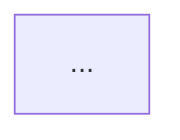

# /architecture - Quét src và vẽ kiến trúc hệ thống

> **Trigger**: `/architecture [phần] [nhanh]`
> **Goal**: Scan the CURRENT code (not old docs) and produce an up-to-date architecture snapshot: one Markdown doc with Mermaid diagrams + polished HTML/SVG diagrams.
> **Output language**: ALWAYS Vietnamese (doc content, diagram labels, final reply). Code identifiers (module names, paths, env vars, ports) stay as-is.
> **Golden rule**: Every box and every arrow must come from code you actually read. Nothing invented. Unverified -> mark `(chưa xác minh)` or leave it out.

---

## Modes

| Input | Mode | What to do |
|-------|------|------------|
| empty | **Toàn bộ** | Scan everything, write the MD doc + all HTML diagrams (D1-D5) |
| `backend` / `frontend` / `db` / `deploy` | **Một phần** | Scan only that part, update only its section in the MD + its HTML diagram |
| `<module>` (e.g. `estimates`, `chat`) | **Một module** | Deep dive one backend module: files, RPC/REST routes, tables it touches, modules it calls, frontend pages calling it. Write `docs/02-ky-thuat/kien-truc/module-<module>.md` + `docs/06-design/kien-truc/module-<module>.html` |
| add `nhanh` | **Nhanh** | Only the MD with Mermaid, skip HTML diagrams |

---

## Step 1 - Scan (fan-out, read-only)

Read `CLAUDE.md` and `.claude/rules/code/folder-structure.md` first (map of the repo). Then spawn **up to 5 Explore agents in ONE message** (per `.claude/rules/agent/multi-agent.md`). Each returns facts as short bullets with `path:line` proof, no file dumps. In single-part / single-module mode, use only the agents that matter (often just 1, or scan directly).

| Agent | Scope | Must return |
|-------|-------|-------------|
| A. Backend core | `backend/cmd/*`, `backend/internal/server/` (esp. MODULE WIRING in `routes.go`, `rest.go`, `rpc/`), `middleware/`, `platform/`, `jobs/`, `shared/`, `config/` | Entry points; request path (Gin -> middleware order -> `/api/:fn` RPC + `/api/v1` REST -> module); platform services (DB, Redis, MinIO/S3, storage, mailer, webpush, logger) and whether each is required or optional (env flag); background jobs + schedule |
| B. Backend modules | every `backend/internal/modules/<module>/` | Per module: 1-line purpose, number of RPC fns (`reg.Register`) and REST routes, permission level used (`rpc.Login/Public/Admin/Super`), other modules it depends on (via `Deps`, `shared/contracts`), external services it calls (Lark, mail, push, S3) |
| C. Frontend | `frontend/src/App.jsx`, `main.jsx`, `pages/*`, `components/layout`, `data/navigation.js`, every `api.js` / `pages/QS/api/*`, `context/`, `public/chat-sw.js` | Route list -> page; which pages are real (call the server) vs mock (use `data/*Data.js` only); for real pages, which backend endpoints/modules they call; state management; how auth token / `VITE_API_URL` is handled; realtime (WebSocket/SSE) and push usage |
| D. Data | `infra/db/schema.sql`, `infra/db/migrations/` (count + latest number), `backend/internal/platform/database/db-map.json`, `postgres.go` per module | Tables grouped by owning module; key FK relationships between groups (not every column); tenant column / scoping; latest migration number |
| E. Deploy & ngoài | `infra/deploy/*` (docker-compose, Caddyfile, scripts), `infra/docker/*`, `backend/.env.example`, `frontend/.env.example` | Containers/services, ports, volumes, domain routing in Caddy, backup scripts; every external system (Lark webhook, SMTP, web push, S3/MinIO, ...) with the env var that enables it |

Also record: current commit `git rev-parse --short HEAD`, branch, today's date.

## Step 2 - Synthesize (no new reading unless a gap)

Merge agent results, dedupe, resolve conflicts by reading the code yourself. Then decide the diagrams. Before drawing, state in one line per diagram: type + node count + what is omitted (as `diagram-design` §3 requires).

| ID | Diagram | Type | Content |
|----|---------|------|---------|
| D1 | Tổng quan hệ thống | Architecture | Người dùng (trình duyệt / mobile PWA) -> Caddy -> frontend tĩnh + backend Go -> PostgreSQL, Redis, MinIO, ổ đĩa uploads; hệ thống ngoài (Lark, mail, push). Max ~9 nodes, accent = backend Go |
| D2 | Các tầng backend | Layer stack | server/rpc + REST -> middleware -> modules -> shared/contracts -> platform -> hạ tầng |
| D3 | Bản đồ module | Nested | 18+ modules is above the node limit: group modules into business domains (e.g. Nền tảng: auth, users, companies, system, notifications, files; QS: categories, materials, takeoff, estimates, quotations; Vận hành: projects, purchasing, delivery, sales, hr, reports; Giao tiếp: chat) - derive groups from what the code actually does, not from this example. Draw only cross-domain dependencies |
| D4 | Frontend -> backend | Architecture / swimlane | Page groups (real vs mock clearly distinguished, mock = dashed) -> backend modules they call |
| D5 | Triển khai | Architecture | docker-compose services, ports, volumes, Caddy routing, backup |

Any diagram over the `diagram-design` §6 limits -> split into overview + detail, do not cram.

## Step 3 - Write the Markdown doc

Path: `docs/02-ky-thuat/kien-truc/kien-truc-he-thong.md` (create the folder if missing). This is a **living snapshot**: overwrite it each run, but FIRST read the old version (if any) and fill section 9 with what changed.

Template:

````markdown
# Kiến trúc hệ thống QS Pro

| Mục | Giá trị |
|-----|---------|
| Cập nhật | YYYY-MM-DD |
| Commit | `<hash>` (nhánh `<branch>`) |
| Sinh bởi | `/architecture` - chạy lại lệnh để cập nhật, đừng sửa tay |
| Sơ đồ đẹp (HTML) | [docs/06-design/kien-truc/](../../06-design/kien-truc/) |

## 1. Tóm tắt
3-5 câu: hệ thống gồm những khối nào, chạy ở đâu, dữ liệu nằm đâu.

## 2. Tổng quan (D1)

Bảng: Thành phần | Công nghệ | Vai trò | Bắt buộc / tuỳ chọn (biến môi trường).

## 3. Backend (D2)
Mermaid + đường đi của 1 request (từ trình duyệt đến DB) theo từng bước, có `path:line`.
Bảng middleware theo thứ tự chạy.

## 4. Module nghiệp vụ (D3)
Mermaid + bảng: Module | Nhóm | Làm gì | Số RPC / REST | Bảng DB chính | Gọi module nào.

## 5. Frontend (D4)
Mermaid + bảng: Trang | Route | Thật / Mock | Gọi module backend nào.

## 6. Dữ liệu
Bảng nhóm bảng DB theo module + quan hệ chính. Migration mới nhất: `NNNN_...`.
Trỏ tới [schema-hien-hanh.md](../database/schema-hien-hanh.md) cho chi tiết cột, KHÔNG chép lại.

## 7. Triển khai (D5)
Mermaid + bảng container. Trỏ tới [trien-khai-vps-cloudfly.md](../../04-van-hanh/trien-khai-vps-cloudfly.md) cho thao tác.

## 8. Tích hợp ngoài & job nền
Bảng: Hệ thống / Job | Dùng để | Bật bằng | File.

## 9. Thay đổi so với lần quét trước
- Module / trang / bảng / service mới, bị gỡ, đổi tên. Lần đầu: ghi "Lần quét đầu tiên".

## 10. Điểm đáng chú ý
Chỉ những gì thấy trong code: phụ thuộc vòng, module quá lớn, trang còn mock, service tuỳ chọn đang tắt, chỗ lệch giữa docs cũ và code. Mỗi ý có `path:line`. Không đề xuất refactor trừ khi rõ ràng.
````

Mermaid rules: ASCII node ids, Vietnamese labels in brackets, `flowchart LR` or `TD`, keep each under ~15 nodes (Mermaid is the quick version; the HTML is the polished one).

## Step 4 - Draw the HTML diagrams (skip in `nhanh` mode)

Load and follow the `diagram-design` skill (`.claude/skills/diagram-design/SKILL.md`) exactly: palette, fonts, elbow connectors, ≤2 accent nodes, legend strip, a11y contract, self-check §7.

- Path: `docs/06-design/kien-truc/<id>-<slug>.html`, e.g. `d1-tong-quan.html`, `d2-tang-backend.html`, `d3-ban-do-module.html`, `d4-frontend-backend.html`, `d5-trien-khai.html`. Overwrite on each run.
- Also write `docs/06-design/kien-truc/index.html`: one page embedding all diagrams in order (D1 -> D5) with a header (title, date, commit) so the user opens one file to see everything.
- Each diagram footer (colophon): `QS Pro · commit <hash> · YYYY-MM-DD · /architecture`.

## Step 5 - Index

Per `.claude/rules/docs/docs-placement.md`: ensure `docs/README.md` has one row for `02-ky-thuat/kien-truc/kien-truc-he-thong.md` and one for `06-design/kien-truc/index.html` (add a section if missing; never duplicate rows on re-runs).

## Step 6 - Reply (Vietnamese, ≤ 8 lines)

- Links to the MD doc and `index.html`.
- Counts: số module, số trang (thật / mock), số bảng DB, số service ngoài.
- Top 3 items from "Thay đổi so với lần quét trước" and from "Điểm đáng chú ý".
- No retelling of the whole doc.

---

## Self-check before finishing

- [ ] Every node/arrow traced to code read in THIS run (not copied from old docs)
- [ ] Old version read and section 9 filled before overwriting
- [ ] Module list matches `ls backend/internal/modules` exactly; page list matches `App.jsx` routes
- [ ] Real vs mock pages verified by checking for server calls, not guessed from names
- [ ] Optional services marked with the env var that toggles them
- [ ] Every diagram within `diagram-design` §6 limits, or split
- [ ] HTML passes `diagram-design` §7 checklist; `index.html` opens and shows all diagrams
- [ ] `docs/README.md` index updated, no duplicate rows
- [ ] All `path:line` references verified
