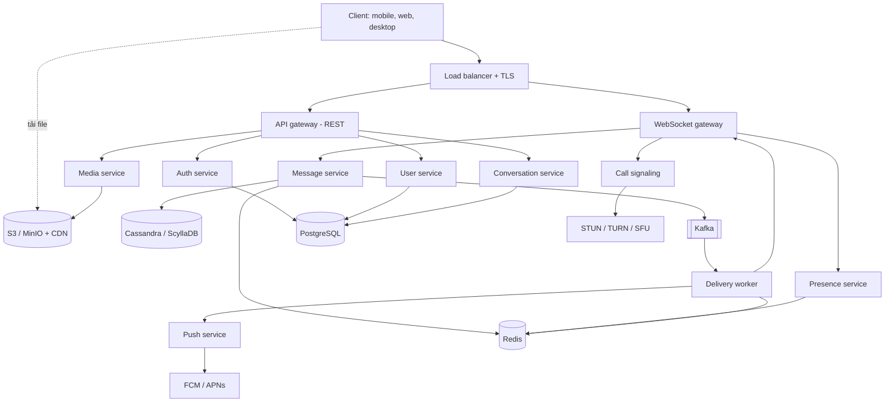
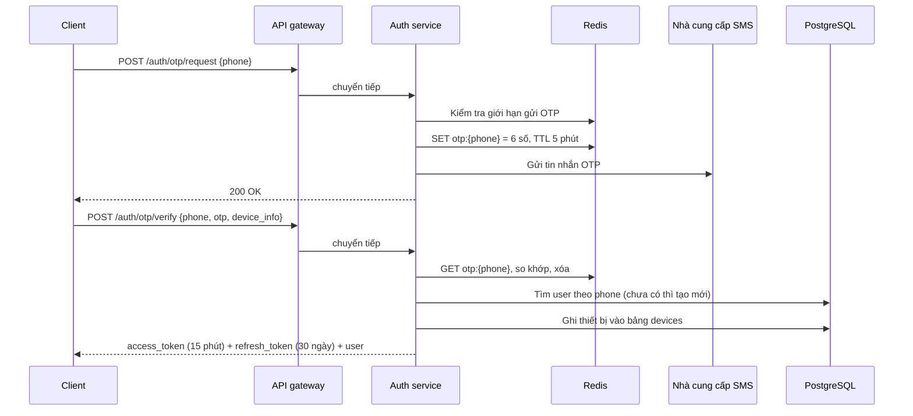
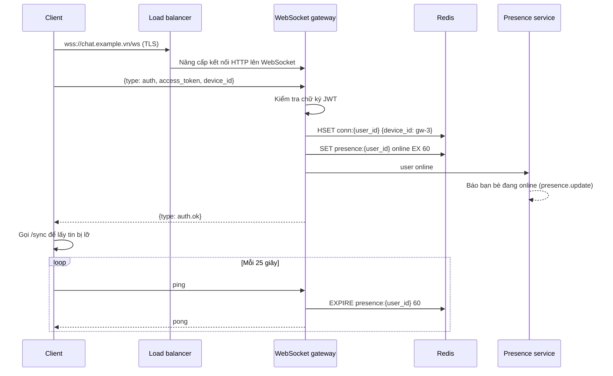
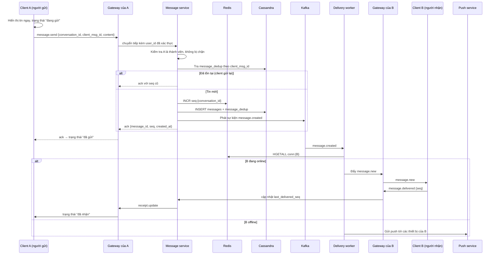
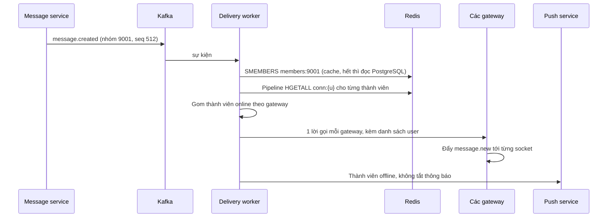
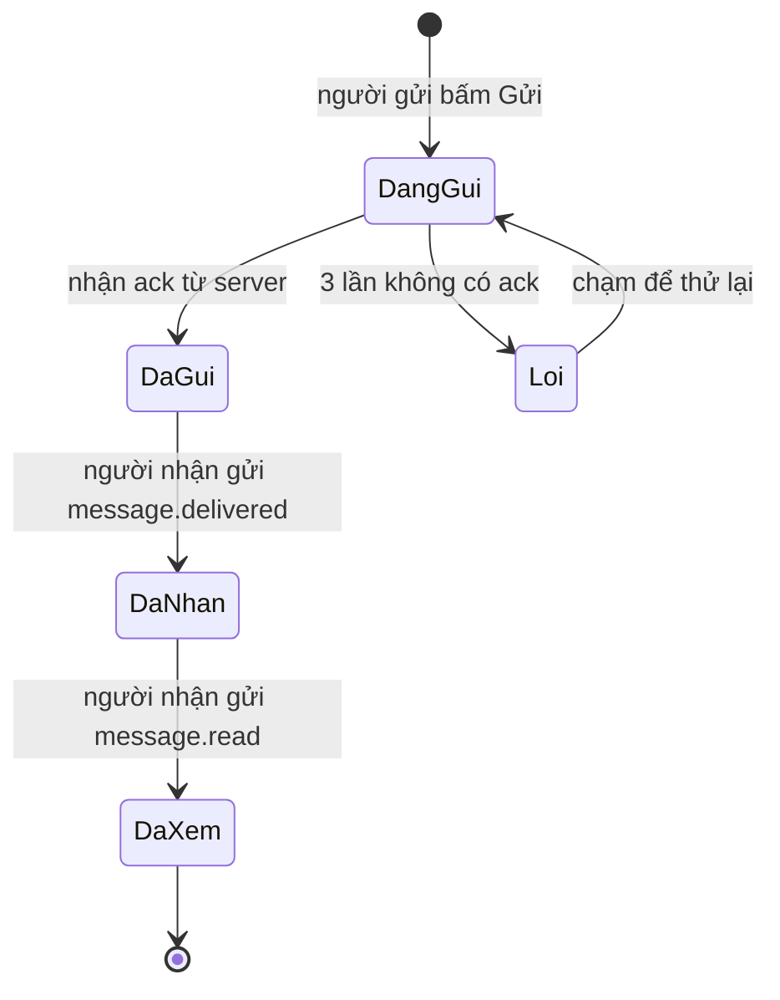
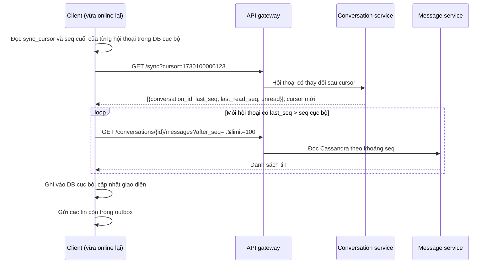
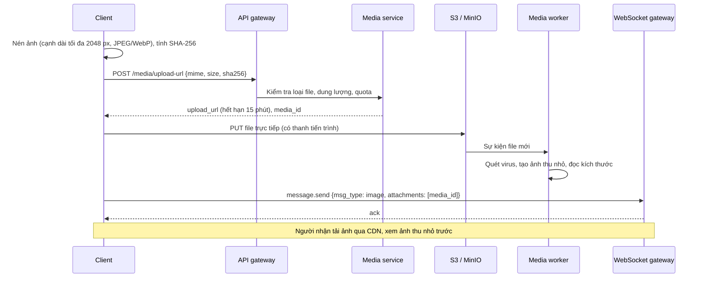
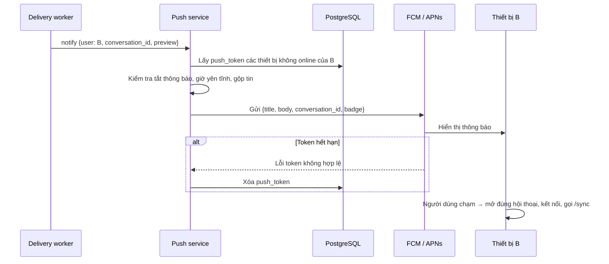
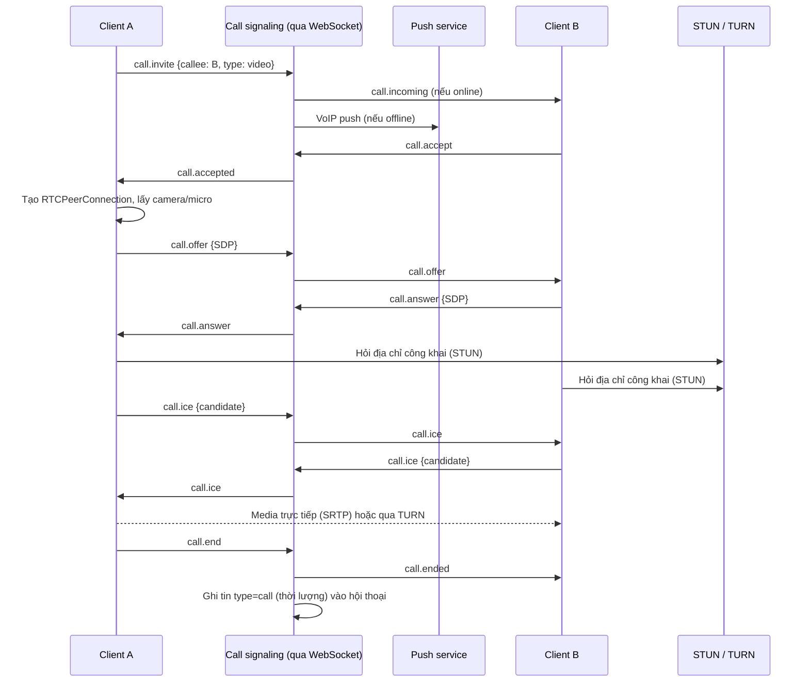

## 1. Tổng quan và phạm vi

Mục tiêu: xây dựng ứng dụng nhắn tin thời gian thực (mobile + web) cho phép chat 1-1, chat nhóm, gửi ảnh/file và gọi thoại/video. Tin nhắn phải đến người nhận trong dưới 1 giây khi cả hai online, không mất và không trùng khi mạng chập chờn.

Tài liệu chia làm ba phần: kiến trúc và dữ liệu (mục 2–5), các luồng hoạt động chi tiết (mục 6–14), vận hành và lộ trình (mục 15–16).

### Phạm vi theo giai đoạn

| Giai đoạn | Tính năng |
| --- | --- |
| MVP | Đăng ký/đăng nhập bằng số điện thoại + OTP; danh bạ, kết bạn; chat 1-1 và nhóm (text); đã gửi / đã nhận / đã xem; online, đang soạn tin; push notification |
| Giai đoạn 2 | Ảnh, video, file, tin nhắn thoại; trả lời, chuyển tiếp, thu hồi, chỉnh sửa tin; reaction; tìm kiếm tin nhắn; đa thiết bị (điện thoại + máy tính) |
| Giai đoạn 3 | Gọi thoại/video 1-1 và nhóm; mã hóa đầu cuối; bot, mini app; nhóm lớn/cộng đồng |

### Yêu cầu phi chức năng

- Độ trễ gửi–nhận: dưới 500 ms trong cùng khu vực.
- Không mất tin: tin đã báo "đã gửi" phải nằm bền trong cơ sở dữ liệu.
- Không trùng tin khi client gửi lại (idempotent).
- Thứ tự tin đúng trong từng cuộc trò chuyện.
- Mở rộng ngang: thêm máy chủ để phục vụ thêm người dùng, không sửa code.

## 2. Kiến trúc tổng thể

Client dùng hai kênh: REST cho thao tác thông thường và WebSocket cho thời gian thực; tin nhắn được lưu trước rồi mới phân phối bất đồng qua Kafka.



- **Lớp truy cập:** load balancer, API gateway, WebSocket gateway.
- **Lớp nghiệp vụ:** Auth, User, Conversation, Message, Presence, Media, Push, Call signaling.
- **Lớp bất đồng:** Kafka + Delivery worker tách việc lưu tin khỏi việc đẩy tin.
- **Lớp dữ liệu:** PostgreSQL (quan hệ), Cassandra (tin nhắn), Redis (trạng thái tạm, seq), S3 (file).

## 3. Các thành phần hệ thống

Mỗi thành phần là một service độc lập, không giữ trạng thái (trừ WebSocket gateway giữ kết nối), nên có thể chạy nhiều bản sau load balancer.

| Thành phần | Nhiệm vụ | Giao tiếp với |
| --- | --- | --- |
| Client (mobile, web, desktop) | Giao diện; giữ kết nối WebSocket; lưu tin cục bộ (SQLite/IndexedDB); hàng đợi gửi lại khi mất mạng | API gateway, WebSocket gateway, CDN |
| Load balancer | Phân phối HTTP và WebSocket; kết thúc TLS | Client, các gateway |
| API gateway (REST) | Xác thực JWT, giới hạn tốc độ, định tuyến tới service | Auth, User, Conversation, Media service |
| WebSocket gateway | Giữ kết nối lâu dài; nhận gói tin từ client; đẩy tin xuống client; ghi ánh xạ user → gateway vào Redis | Message service, Redis, Kafka |
| Auth service | OTP, đăng ký, cấp access token và refresh token, quản lý thiết bị | PostgreSQL, Redis, nhà cung cấp SMS |
| User service | Hồ sơ, danh bạ, kết bạn, chặn | PostgreSQL |
| Conversation service | Tạo cuộc trò chuyện, thành viên nhóm, quyền quản trị, danh sách hội thoại | PostgreSQL, Redis |
| Message service | Kiểm tra quyền, cấp `seq`, lưu tin, phát sự kiện lên Kafka | Cassandra/ScyllaDB, Redis, Kafka |
| Delivery worker | Đọc Kafka, tra người nhận đang online ở gateway nào, đẩy tin; người offline → gửi sang Push | Kafka, Redis, WebSocket gateway |
| Presence service | Online/offline, lần truy cập cuối, đang soạn tin | Redis |
| Media service | Cấp URL tải lên (presigned URL), tạo ảnh thu nhỏ, kiểm tra virus | S3/MinIO, CDN |
| Push service | Gửi thông báo qua FCM (Android, web) và APNs (iOS) | FCM, APNs |
| Call signaling | Trao đổi SDP/ICE cho WebRTC; tín hiệu gọi, nhận, từ chối | WebSocket gateway, TURN/SFU |
| Search service | Tìm kiếm tin nhắn, liên hệ | Elasticsearch/OpenSearch |

## 4. Thiết kế cơ sở dữ liệu

Dữ liệu quan hệ (người dùng, nhóm) nằm trong PostgreSQL; tin nhắn nằm trong Cassandra/ScyllaDB vì ghi rất nhiều và luôn đọc theo từng cuộc trò chuyện. Giai đoạn đầu có thể dùng PostgreSQL cho tất cả, giữ nguyên cấu trúc bên dưới để sau này tách ra.

### PostgreSQL

```sql
CREATE TABLE users (
  id            BIGINT PRIMARY KEY,          -- Snowflake ID
  phone         VARCHAR(20) UNIQUE NOT NULL,
  display_name  VARCHAR(100) NOT NULL,
  avatar_url    TEXT,
  created_at    TIMESTAMPTZ NOT NULL DEFAULT now()
);

CREATE TABLE devices (
  id            BIGINT PRIMARY KEY,
  user_id       BIGINT NOT NULL REFERENCES users(id),
  platform      VARCHAR(10) NOT NULL,         -- ios | android | web | desktop
  push_token    TEXT,
  last_seen_at  TIMESTAMPTZ
);

CREATE TABLE friendships (
  user_id       BIGINT NOT NULL,
  friend_id     BIGINT NOT NULL,
  status        VARCHAR(10) NOT NULL,         -- pending | accepted | blocked
  created_at    TIMESTAMPTZ NOT NULL DEFAULT now(),
  PRIMARY KEY (user_id, friend_id)
);

CREATE TABLE conversations (
  id            BIGINT PRIMARY KEY,
  type          VARCHAR(10) NOT NULL,         -- direct | group
  name          VARCHAR(100),
  avatar_url    TEXT,
  last_seq      BIGINT NOT NULL DEFAULT 0,    -- seq của tin mới nhất
  last_message_at TIMESTAMPTZ,
  created_by    BIGINT NOT NULL,
  created_at    TIMESTAMPTZ NOT NULL DEFAULT now()
);

CREATE TABLE conversation_members (
  conversation_id    BIGINT NOT NULL REFERENCES conversations(id),
  user_id            BIGINT NOT NULL REFERENCES users(id),
  role               VARCHAR(10) NOT NULL DEFAULT 'member', -- owner | admin | member
  last_read_seq      BIGINT NOT NULL DEFAULT 0,
  last_delivered_seq BIGINT NOT NULL DEFAULT 0,
  muted_until        TIMESTAMPTZ,
  joined_at          TIMESTAMPTZ NOT NULL DEFAULT now(),
  PRIMARY KEY (conversation_id, user_id)
);
CREATE INDEX idx_members_user ON conversation_members(user_id);

-- Chat 1-1: đảm bảo mỗi cặp người chỉ có một cuộc trò chuyện
CREATE TABLE direct_pairs (
  user_low        BIGINT NOT NULL,
  user_high       BIGINT NOT NULL,
  conversation_id BIGINT NOT NULL,
  PRIMARY KEY (user_low, user_high)
);
```

### Cassandra / ScyllaDB

```sql
CREATE TABLE messages (
  conversation_id  bigint,
  bucket           int,        -- ví dụ: seq / 10000, tránh partition quá lớn
  seq              bigint,
  message_id       bigint,     -- Snowflake ID
  client_msg_id    uuid,       -- chống trùng khi client gửi lại
  sender_id        bigint,
  type             text,       -- text | image | file | voice | system | call
  content          text,
  attachments      text,       -- JSON: url, size, mime, thumbnail
  reply_to         bigint,
  edited_at        timestamp,
  deleted          boolean,
  created_at       timestamp,
  PRIMARY KEY ((conversation_id, bucket), seq)
) WITH CLUSTERING ORDER BY (seq DESC);

CREATE TABLE message_dedup (
  conversation_id bigint,
  client_msg_id   uuid,
  seq             bigint,
  PRIMARY KEY ((conversation_id, client_msg_id))
) WITH default_time_to_live = 86400;
```

### Redis

| Khóa | Giá trị | Dùng để |
| --- | --- | --- |
| `conn:{user_id}` | Hash: device\_id → gateway\_id | Biết người dùng đang kết nối ở gateway nào |
| `presence:{user_id}` | online, TTL 60 giây | Trạng thái online, làm mới theo heartbeat |
| `seq:{conversation_id}` | Số nguyên, `INCR` | Cấp `seq` tăng dần, nguyên tử |
| `typing:{conversation_id}` | Set user\_id, TTL 5 giây | "Đang soạn tin…" |
| `otp:{phone}` | Mã OTP, TTL 5 phút | Xác thực đăng nhập |
| `members:{conversation_id}` | Set user\_id | Cache thành viên nhóm khi fan-out |

Nguyên tắc: `seq` tăng dần theo từng cuộc trò chuyện là xương sống của hệ thống. Nó dùng để sắp xếp tin, đồng bộ khi mất mạng ("cho tôi các tin có seq > 120"), và tính số tin chưa đọc (`last_seq - last_read_seq`).

## 5. Giao thức WebSocket và REST API

REST dùng cho thao tác không cần tức thời (đăng nhập, lấy lịch sử, tạo nhóm); WebSocket dùng cho mọi thứ thời gian thực (gửi/nhận tin, trạng thái, cuộc gọi).

### Định dạng gói tin WebSocket

Mọi gói tin là JSON (giai đoạn sau có thể chuyển sang Protobuf để giảm dung lượng):

```json
{
  "type": "message.send",
  "req_id": "c-8f21",
  "data": {
    "conversation_id": 9001,
    "client_msg_id": "6b1e0c7a-3f0e-4c51-9a0e-2d4b7f1c9e11",
    "msg_type": "text",
    "content": "Chào bạn"
  }
}
```

`req_id` do client tự sinh để khớp phản hồi `ack` với yêu cầu.

### Các sự kiện

| Hướng | type | Dữ liệu chính | Ý nghĩa |
| --- | --- | --- | --- |
| Client → Server | `auth` | access\_token, device\_id | Xác thực ngay sau khi mở kết nối |
| Client → Server | `ping` | — | Heartbeat mỗi 25 giây |
| Client → Server | `message.send` | conversation\_id, client\_msg\_id, msg\_type, content | Gửi tin |
| Client → Server | `message.delivered` | conversation\_id, seq | Đã nhận đến seq này |
| Client → Server | `message.read` | conversation\_id, seq | Đã xem đến seq này |
| Client → Server | `typing.start` / `typing.stop` | conversation\_id | Đang soạn tin |
| Server → Client | `ack` | req\_id, message\_id, seq, created\_at | Server đã lưu tin |
| Server → Client | `error` | req\_id, code, message | Lỗi (không có quyền, quá giới hạn…) |
| Server → Client | `message.new` | tin nhắn đầy đủ | Có tin mới |
| Server → Client | `receipt.update` | conversation\_id, user\_id, delivered\_seq, read\_seq | Người khác đã nhận/xem |
| Server → Client | `presence.update` | user\_id, online, last\_seen | Thay đổi online |
| Server → Client | `typing` | conversation\_id, user\_id, is\_typing | Ai đó đang soạn |
| Hai chiều | `call.*` | offer, answer, ice, end | Tín hiệu cuộc gọi |

### REST API chính

| Phương thức | Đường dẫn | Mục đích |
| --- | --- | --- |
| POST | `/auth/otp/request` | Gửi OTP về số điện thoại |
| POST | `/auth/otp/verify` | Xác thực OTP, trả về access + refresh token |
| POST | `/auth/refresh` | Lấy access token mới |
| GET | `/conversations?cursor=` | Danh sách hội thoại, sắp theo tin mới nhất, kèm số tin chưa đọc |
| POST | `/conversations` | Tạo chat 1-1 hoặc nhóm |
| POST | `/conversations/{id}/members` | Thêm thành viên nhóm |
| GET | `/conversations/{id}/messages?before_seq=&limit=50` | Cuộn lịch sử cũ hơn |
| GET | `/sync?cursor=` | Lấy mọi thay đổi kể từ lần đồng bộ trước |
| POST | `/media/upload-url` | Xin presigned URL để tải file lên |
| POST | `/devices` | Đăng ký push token |

## 6. Luồng đăng ký và đăng nhập

Người dùng đăng nhập bằng số điện thoại + OTP; nếu số chưa tồn tại thì tạo tài khoản mới trong cùng luồng.



1. Client gửi số điện thoại. Auth service kiểm tra giới hạn (ví dụ tối đa 5 OTP/giờ/số và theo IP) để chống spam SMS.
2. Sinh mã 6 chữ số, lưu vào Redis với TTL 5 phút, gửi qua SMS hoặc Zalo ZNS.
3. Client gửi lại OTP. Sai quá 5 lần thì khóa số đó 15 phút.
4. Đúng OTP: tìm hoặc tạo user, đăng ký thiết bị, cấp JWT access token ngắn hạn và refresh token dài hạn (lưu dạng hash trong DB để thu hồi được).
5. Khi access token hết hạn, client gọi `/auth/refresh`. Mỗi lần refresh cấp refresh token mới và vô hiệu cái cũ (rotation); nếu một token cũ bị dùng lại thì thu hồi toàn bộ phiên của thiết bị đó.
6. Đăng xuất: xóa refresh token và push token của thiết bị, đóng kết nối WebSocket.

Người dùng mới sau đó tải danh bạ lên (chỉ gửi hash số điện thoại nếu muốn bảo vệ riêng tư) để gợi ý bạn bè đang dùng ứng dụng.

**Đăng nhập bằng email** (migration 0019): cùng luồng trên, client gửi `{email}` thay cho `{phone}` ở `/auth/otp/request` và `/auth/otp/verify`
(gửi cả hai -> 400). Email được chuẩn hoá (bỏ khoảng trắng hai đầu, chữ thường; sai -> `EMAIL_INVALID`), mã 6 số gửi qua SMTP (`SMTP_*`; chưa
cấu hình thì ghi log) với cùng giới hạn như SMS (5 mã / giờ / email, đếm chung theo IP, sai 5 lần khoá 15 phút). Email chưa có tài khoản thì tạo
tài khoản mới không có số điện thoại (tên mặc định = phần trước `@`). Tài khoản email và tài khoản số là HAI tài khoản riêng, chưa liên kết.
Tìm bạn bằng email: `GET /users/search?email=` (chỉ khớp đúng email), rồi gửi lời mời kết bạn bằng `user_id` như với số.

## 7. Luồng kết nối realtime

Mỗi thiết bị đang mở app giữ đúng một kết nối WebSocket; Redis ghi lại kết nối đó nằm ở gateway nào để các service khác tìm được.



1. Client mở kết nối `wss://` tới load balancer. Load balancer chọn một gateway (thuật toán least-connections).
2. Gói đầu tiên phải là `auth`. Nếu sau 10 giây chưa xác thực, gateway đóng kết nối.
3. Gateway ghi `conn:{user_id}` và `presence:{user_id}` vào Redis, giữ kết nối trong bộ nhớ (map device\_id → socket).
4. Client gọi `/sync` ngay sau khi kết nối để nhận những gì xảy ra lúc nó offline (mục 11).
5. Heartbeat: client gửi `ping` mỗi 25 giây; gateway gia hạn TTL presence. Không nhận được `pong` trong 10 giây → client coi kết nối đã chết.
6. Ngắt kết nối: gateway xóa device khỏi `conn:{user_id}`. Nếu người dùng không còn thiết bị nào, để presence tự hết TTL và ghi `last_seen`.
7. Kết nối lại: client thử lại theo exponential backoff có jitter (1 s, 2 s, 4 s… tối đa 30 s) để hàng triệu máy không cùng dồn vào server sau sự cố. Khi mạng đổi (Wi-Fi → 4G) thì kết nối lại ngay.
8. Triển khai gateway mới: gửi gói `reconnect` cho client rồi đóng từ từ (drain) thay vì cắt đột ngột.

Trên iOS/Android, khi app chạy nền hệ điều hành sẽ đóng WebSocket; lúc đó tin nhắn đến qua push notification (mục 13).

## 8. Luồng gửi tin nhắn 1-1

Tin chỉ được báo "đã gửi" sau khi đã nằm bền trong cơ sở dữ liệu; việc đẩy tới người nhận chạy bất đồng qua Kafka nên người gửi không phải chờ.



### Các bước chi tiết

1. **Client A hiển thị ngay (optimistic UI).** Tạo `client_msg_id` (UUID), lưu tin vào DB cục bộ với trạng thái `sending`, vẽ lên màn hình với biểu tượng đồng hồ.
2. **Gửi qua WebSocket.** Nếu chưa có kết nối, tin nằm trong hàng đợi gửi (outbox) và được gửi khi kết nối lại.
3. **Kiểm tra quyền.** Message service xác nhận A thuộc cuộc trò chuyện, không bị B chặn, nội dung không vượt 4.000 ký tự, A không vượt giới hạn tốc độ (ví dụ 20 tin/giây).
4. **Chống trùng.** Nếu `client_msg_id` đã có, trả lại `ack` cũ và dừng. Trường hợp này xảy ra khi server đã lưu nhưng `ack` bị mất trên đường về.
5. **Cấp số thứ tự.** `INCR seq:{conversation_id}` trong Redis cho `seq` tăng dần, không trùng. Sinh `message_id` bằng Snowflake.
6. **Lưu bền.** Ghi vào `messages` và `message_dedup`, cập nhật `conversations.last_seq`, `last_message_at`.
7. **Phát sự kiện** `message.created` lên Kafka, khóa phân vùng = `conversation_id` để giữ thứ tự.
8. **Trả `ack` cho A.** Client A thay `client_msg_id` bằng `message_id` và `seq`, đổi trạng thái thành "đã gửi" (một dấu tích).
9. **Phân phối.** Delivery worker đọc Kafka, tra `conn:{B}` để biết B đang nối ở gateway nào (có thể nhiều thiết bị), gọi nội bộ tới từng gateway đó. Đồng thời đẩy bản sao tới các thiết bị khác của chính A.
10. **B nhận tin.** Client B kiểm tra `seq`: nếu bị hở (ví dụ có seq 41 rồi nhận 43), gọi `/sync` để lấy tin 42. Lưu vào DB cục bộ, hiển thị, gửi `message.delivered`.
11. **B offline.** Worker chuyển sang Push service; tin vẫn nằm trong DB và B sẽ lấy khi mở app.
12. **Thất bại.** Nếu A không nhận được `ack` sau 10 giây, client gửi lại cùng `client_msg_id` (an toàn nhờ bước 4). Sau 3 lần thất bại hiển thị "Gửi lỗi, chạm để thử lại".

### Tạo cuộc trò chuyện 1-1 lần đầu

Khi A nhắn cho B lần đầu, client gọi `POST /conversations {type: direct, user_id: B}`. Server tra `direct_pairs` với (min(A,B), max(A,B)); có rồi thì trả về id cũ, chưa có thì tạo mới trong một transaction. Khóa chính của `direct_pairs` ngăn hai bên cùng lúc tạo ra hai cuộc trò chuyện.

## 9. Luồng tin nhắn nhóm và fan-out

Tin nhóm được lưu đúng một lần (fan-out khi đọc), chỉ việc đẩy thông báo là nhân ra cho từng thành viên. Bước 1–8 giống hệt chat 1-1; khác biệt nằm ở bước phân phối.



1. **Giới hạn nhóm.** Đặt số thành viên tối đa (ví dụ 1.000 cho nhóm thường). Cộng đồng lớn hơn là một loại riêng (giai đoạn 3).
2. **Lấy thành viên.** Worker đọc danh sách từ Redis; cập nhật cache mỗi khi có người vào/ra nhóm.
3. **Gom theo gateway.** Thay vì 1.000 lời gọi, worker gửi mỗi gateway một lần với danh sách user cần nhận. Cách khác: mỗi gateway đăng ký một kênh Redis Pub/Sub riêng (`gw:{id}`) và worker publish vào đó.
4. **Push có chọn lọc.** Bỏ qua thành viên đã tắt thông báo (`muted_until`), trừ khi họ được @nhắc tên. Nhóm sôi nổi thì gộp thành một thông báo "12 tin nhắn mới".
5. **Trạng thái đã xem trong nhóm.** Mỗi thành viên có `last_read_seq` riêng; client hiển thị "đã xem bởi 8 người" bằng cách đếm thành viên có `last_read_seq >= seq`.
6. **Thay đổi thành viên.** Thêm, xóa, đổi tên nhóm sinh ra tin `type = system` ("An đã thêm Bình vào nhóm") đi qua đúng luồng trên, để mọi thiết bị thấy cùng thứ tự. Người mới vào chỉ đọc được tin từ `seq` lúc họ tham gia (nếu nhóm cấu hình như vậy).

## 10. Luồng đã nhận, đã xem, đang soạn và online

Trạng thái tin được lưu bằng một con trỏ `seq` cho mỗi người, không phải từng tin một: "đã xem đến seq 120" nghĩa là mọi tin ≤ 120 đều đã xem.

### Vòng đời trạng thái của một tin



### Đã nhận và đã xem

1. Client B nhận tin → gửi `message.delivered {conversation_id, seq}`.
2. B mở cuộc trò chuyện và tin hiển thị trên màn hình → gửi `message.read {conversation_id, seq lớn nhất đang thấy}`. Client gộp (debounce) 1 giây để không gửi mỗi tin một lần.
3. Server cập nhật `last_delivered_seq` / `last_read_seq` chỉ khi giá trị mới lớn hơn (không bao giờ lùi).
4. Server phát `receipt.update` tới các thành viên khác và tới các thiết bị khác của B (để xóa số tin chưa đọc trên máy tính khi B đã đọc trên điện thoại).
5. Số tin chưa đọc của một hội thoại = `conversations.last_seq - last_read_seq` (trừ tin do chính mình gửi).
6. Người dùng tắt "hiển thị đã xem" trong cài đặt: vẫn cập nhật `last_read_seq` cho chính họ, nhưng không phát `receipt.update` cho người khác.

### Đang soạn tin

1. Người dùng gõ phím → client gửi `typing.start` (tối đa một lần mỗi 3 giây).
2. Gateway chuyển thẳng tới các thành viên đang online qua Redis Pub/Sub, không ghi DB, không qua Kafka.
3. Người nhận hiển thị "đang soạn tin…" và tự ẩn sau 5 giây nếu không có tín hiệu mới, hoặc ngay khi nhận tin mới.

### Online / truy cập lần cuối

1. Online = có khóa `presence:{user_id}` trong Redis (được gia hạn bởi heartbeat).
2. Client không nhận presence của tất cả bạn bè liên tục. Khi mở danh sách hội thoại, client gửi `presence.subscribe` cho khoảng 50 người đang hiển thị; chỉ những người này mới được đẩy `presence.update`.
3. Khi offline, lưu `last_seen` để hiển thị "Truy cập 5 phút trước". Chống nhấp nháy: chỉ báo offline nếu người dùng mất kết nối quá 30 giây.

## 11. Luồng đồng bộ khi offline và đa thiết bị

Client là bản sao cục bộ của dữ liệu trên server; mỗi lần kết nối lại nó chỉ hỏi phần chênh lệch kể từ lần đồng bộ trước, dựa trên `seq`.



### Đồng bộ sau khi mất mạng

1. Client lưu `sync_cursor` (thời điểm hoặc số phiên bản của lần đồng bộ cuối) và `seq` lớn nhất đã có của từng hội thoại.
2. Kết nối lại → gọi `/sync` lấy danh sách hội thoại có thay đổi (tin mới, đổi tên nhóm, bị xóa khỏi nhóm…).
3. Hội thoại nào có `last_seq` lớn hơn bản cục bộ thì tải tin còn thiếu. Nếu thiếu quá nhiều (ví dụ > 500 tin), chỉ tải 50 tin mới nhất và đánh dấu khoảng trống; người dùng cuộn lên mới tải tiếp.
4. Trong lúc đồng bộ, tin realtime vẫn có thể đến qua WebSocket; client chỉ cần ghi theo khóa `(conversation_id, seq)` nên tin trùng sẽ tự gộp.
5. Cuối cùng gửi các tin trong outbox (tin người dùng gõ lúc offline) theo đúng thứ tự.

### Đa thiết bị

1. Mỗi thiết bị đăng nhập là một dòng trong `devices` và một mục trong `conn:{user_id}`.
2. Tin mới được đẩy tới mọi thiết bị của người nhận và mọi thiết bị khác của người gửi.
3. Đăng nhập web/desktop bằng mã QR: máy tính hiển thị QR chứa mã phiên tạm (TTL 2 phút); điện thoại đã đăng nhập quét và xác nhận; server cấp token cho máy tính qua kết nối đang chờ.
4. Thiết bị mới đăng nhập tải lịch sử từ server (không cần đồng bộ máy–máy như Zalo cũ). Nếu sau này dùng mã hóa đầu cuối, phần này phải thiết kế lại.
5. Người dùng xem và đăng xuất từ xa các thiết bị trong mục cài đặt: xóa refresh token, gửi `force_logout` qua WebSocket.

## 12. Luồng gửi ảnh và file

File không đi qua server chat: client tải thẳng lên kho lưu trữ bằng presigned URL, rồi gửi một tin nhắn bình thường chứa đường dẫn.



1. Client nén ảnh trước khi gửi (tuỳ chọn "gửi ảnh gốc" để bỏ qua). Video nén về 720p.
2. Xin presigned URL: server kiểm tra loại file được phép và giới hạn dung lượng (ví dụ ảnh 25 MB, file 1 GB). Nếu `sha256` đã tồn tại thì trả về `media_id` cũ và bỏ qua bước tải lên (chuyển tiếp file không tốn băng thông).
3. Client tải thẳng lên S3. File lớn dùng multipart upload để tiếp tục khi mạng ngắt.
4. Media worker quét virus, tạo ảnh thu nhỏ 320 px, lấy chiều rộng/cao và blurhash để người nhận thấy khung mờ ngay.
5. Client gửi tin `image`/`file` qua luồng mục 8, chỉ chứa `media_id` và siêu dữ liệu.
6. Người nhận tải file qua CDN bằng URL có chữ ký, hết hạn sau vài giờ, để người ngoài không tải được.
7. Tin nhắn thoại: ghi âm Opus/AAC, tải lên như file, kèm thời lượng và dạng sóng.
8. Chính sách lưu trữ: chuyển file cũ hơn 90 ngày sang lớp lưu trữ rẻ hơn; cân nhắc giới hạn thời gian lưu như Zalo để kiểm soát chi phí.

## 13. Luồng push notification

Push chỉ gửi cho thiết bị không có kết nối WebSocket; nó là lời nhắc, còn nội dung thật vẫn được lấy qua `/sync` khi app mở.



1. Khi cài app, client xin quyền thông báo, lấy token từ FCM (Android) hoặc APNs (iOS) và gọi `POST /devices`. Token có thể đổi bất cứ lúc nào, nên client gửi lại mỗi lần mở app.
2. Delivery worker thấy người nhận không có thiết bị nào online → gọi Push service.
3. Push service lọc: hội thoại bị tắt tiếng, người dùng bật "không làm phiền", hoặc vừa gửi push cho hội thoại này trong 3 giây (gộp lại).
4. Nội dung: tên người gửi + 100 ký tự đầu, hoặc chỉ "Bạn có tin nhắn mới" nếu người dùng bật ẩn nội dung. `badge` = tổng số tin chưa đọc.
5. Gửi qua hàng đợi riêng có thử lại, để FCM/APNs chậm không làm nghẽn luồng tin nhắn.
6. Người dùng đọc tin trên thiết bị khác → gửi push "im lặng" để xóa thông báo và cập nhật badge.
7. Cuộc gọi đến dùng loại push ưu tiên cao: VoIP push + CallKit trên iOS, high-priority FCM + màn hình cuộc gọi trên Android.

## 14. Luồng gọi thoại và video

Âm thanh/hình ảnh đi trực tiếp giữa hai máy bằng WebRTC; server chat chỉ làm nhiệm vụ "báo hiệu" (signaling) để hai bên tìm thấy nhau. Khi không nối trực tiếp được (NAT, tường lửa), luồng media đi vòng qua máy chủ TURN.



1. **Mời gọi.** A gửi `call.invite`. Server tạo `call_id`, trạng thái `ringing`, hẹn giờ 45 giây. B nhận qua WebSocket hoặc VoIP push (iOS bắt buộc hiển thị qua CallKit).
2. **Nhận hoặc từ chối.** B nhận → `call.accept`; từ chối, bận hoặc hết 45 giây → server ghi "cuộc gọi nhỡ". B có nhiều thiết bị thì tất cả đổ chuông, thiết bị nào nhận trước thì các máy còn lại nhận `call.cancelled`.
3. **Trao đổi SDP.** Hai bên trao đổi offer/answer mô tả codec (Opus cho âm thanh, VP8/H.264 cho video).
4. **Trao đổi ICE candidate.** Mỗi bên hỏi STUN để biết địa chỉ công khai, rồi gửi các đường nối có thể cho bên kia. WebRTC tự thử và chọn đường tốt nhất; không đường trực tiếp nào được thì dùng TURN.
5. **Trong cuộc gọi.** Mạng đổi (Wi-Fi → 4G) → ICE restart qua signaling. Chất lượng video tự giảm khi băng thông yếu.
6. **Kết thúc.** Một bên gửi `call.end`; server ghi một tin `type = call` ("Cuộc gọi video · 12 phút") vào hội thoại.
7. **Gọi nhóm.** Không nối từng cặp (quá nặng từ 4 người trở lên) mà dùng máy chủ SFU (LiveKit, mediasoup, Janus): mỗi người gửi một luồng lên SFU, SFU chuyển cho những người còn lại.

TURN tốn băng thông nhất trong hệ thống (một cuộc gọi video đi qua TURN khoảng 1–2 Mbps mỗi chiều), nên đặt máy chủ TURN (coturn) gần người dùng và cấp thông tin đăng nhập TURN tạm thời theo từng cuộc gọi.

## 15. Bảo mật, mở rộng và vận hành

### Bảo mật

- TLS 1.2+ cho mọi kết nối; certificate pinning trên app mobile.
- Access token ngắn hạn (15 phút), refresh token xoay vòng, thu hồi được theo thiết bị.
- Mọi thao tác trên hội thoại đều kiểm tra quyền thành viên ở server, không tin dữ liệu từ client.
- Giới hạn tốc độ theo user, IP, thiết bị: OTP, gửi tin, tạo nhóm, kết bạn.
- Chống spam: chặn người lạ, báo cáo vi phạm, lọc liên kết độc hại, giới hạn tin gửi cho người chưa kết bạn.
- Mã hóa dữ liệu lưu trữ (ổ đĩa, S3). Mã hóa đầu cuối theo Signal Protocol là bước sau, ảnh hưởng tới tìm kiếm, đa thiết bị và sao lưu.
- Tuân thủ Luật An ninh mạng, Nghị định 13/2023 về bảo vệ dữ liệu cá nhân và Nghị định 147/2024 về dịch vụ internet (lưu trữ dữ liệu tại Việt Nam, xác thực tài khoản bằng số điện thoại). Nên tham vấn luật sư trước khi phát hành công khai.

### Mở rộng

| Nút thắt | Giải pháp |
| --- | --- |
| Số kết nối WebSocket | Mỗi gateway (Go/Elixir) giữ 100–500 nghìn kết nối; thêm máy khi cần; tăng giới hạn file descriptor của hệ điều hành |
| Ghi tin nhắn | Cassandra/ScyllaDB phân mảnh theo `(conversation_id, bucket)`; thêm node để tăng thông lượng |
| Cấp `seq` | Redis Cluster phân mảnh theo `conversation_id`; dự phòng bằng `last_seq` trong DB khi Redis mất dữ liệu |
| Phân phối tin | Kafka nhiều partition, nhiều delivery worker trong một consumer group |
| Danh sách hội thoại | Cache trong Redis (sorted set theo thời gian tin cuối) cho người dùng hoạt động |
| File | CDN trước S3; chống trùng bằng SHA-256 |
| Người dùng nhiều vùng | Triển khai nhiều khu vực, định tuyến người dùng tới khu vực gần nhất |

### Giám sát và vận hành

- Chỉ số cần theo dõi: số kết nối đang mở, độ trễ gửi–ack (p50, p99), độ trễ gửi–nhận, độ trễ Kafka (consumer lag), tỷ lệ push thất bại, tỷ lệ cuộc gọi dùng TURN.
- Công cụ: Prometheus + Grafana (chỉ số), Loki hoặc ELK (log), OpenTelemetry + Jaeger (truy vết một tin qua nhiều service), Sentry (lỗi client).
- Triển khai: Docker + Kubernetes; gateway cần drain kết nối trước khi tắt (mục 7).
- Sao lưu PostgreSQL hằng ngày + WAL; Cassandra snapshot; thử khôi phục định kỳ.
- Kiểm thử tải: mô phỏng hàng trăm nghìn kết nối bằng k6 hoặc Gatling trước khi ra mắt.

## 16. Công nghệ đề xuất và lộ trình

### Công nghệ

| Lớp | Bắt đầu (đơn giản) | Khi mở rộng |
| --- | --- | --- |
| Mobile | Flutter hoặc React Native | Giữ nguyên, tối ưu phần native (CallKit, push) |
| Web/desktop | React/Next.js; Electron hoặc Tauri | Giữ nguyên |
| Backend | Node.js (NestJS) + Socket.IO hoặc ws | Go hoặc Elixir cho WebSocket gateway |
| Tin nhắn | PostgreSQL (bảng messages phân vùng) | Cassandra / ScyllaDB |
| Trạng thái tạm | Redis | Redis Cluster |
| Hàng đợi | Redis Streams hoặc NATS | Kafka |
| File | MinIO / S3 + CDN | Giữ nguyên |
| Tìm kiếm | PostgreSQL full-text | Elasticsearch / OpenSearch |
| Gọi | WebRTC + coturn; LiveKit cho nhóm | Thêm SFU nhiều khu vực |
| Hạ tầng | Docker Compose, 1–2 máy chủ | Kubernetes, nhiều vùng |

### Lộ trình

1. **Tháng 1–2 — MVP:** đăng nhập OTP, danh bạ, chat 1-1 và nhóm (text), WebSocket một gateway, đã gửi/đã xem, push, đồng bộ offline. Mục tiêu: 10 nghìn người dùng đồng thời.
2. **Tháng 3–4 — Media:** ảnh, file, tin thoại, trả lời/thu hồi/reaction, đa thiết bị, đăng nhập web bằng QR.
3. **Tháng 5–6 — Gọi:** gọi thoại/video 1-1, sau đó gọi nhóm qua SFU.
4. **Khi có tăng trưởng:** tách WebSocket gateway, thêm Kafka, chuyển tin nhắn sang Cassandra, giám sát đầy đủ, kiểm thử tải.
5. **Sau đó:** mã hóa đầu cuối, tìm kiếm nâng cao, bot, cộng đồng lớn.

Đội ngũ tối thiểu cho MVP: 1–2 backend, 1–2 mobile, 1 web, 0,5 DevOps, 1 QA. Nếu cần ra mắt nhanh hơn, cân nhắc dịch vụ có sẵn (Stream Chat, Sendbird) hoặc Matrix mã nguồn mở.
