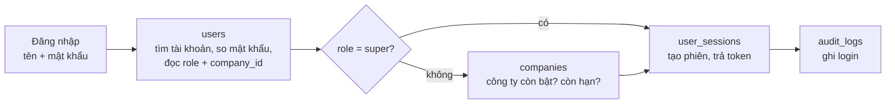
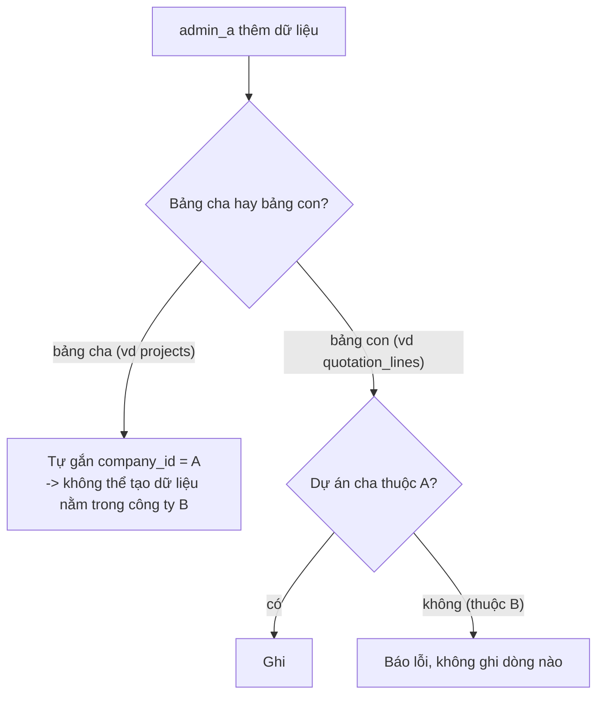
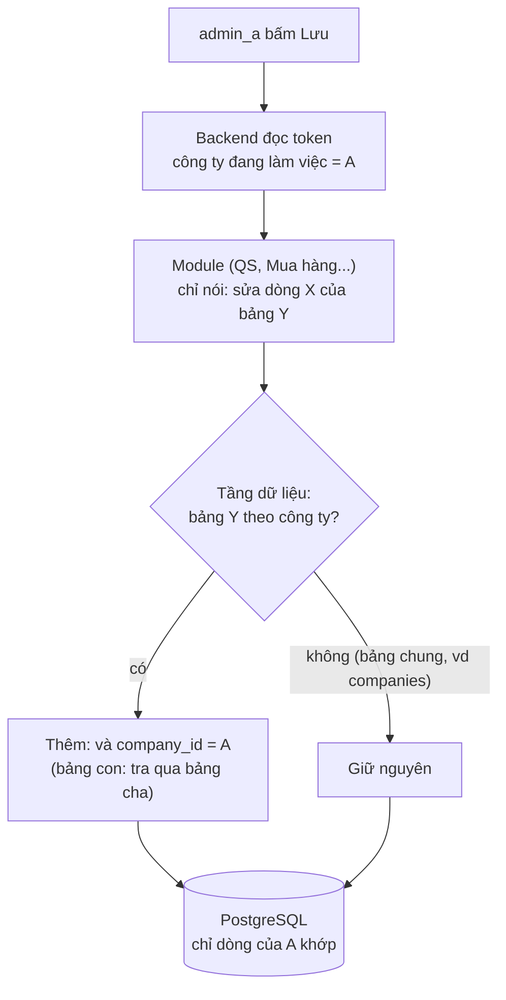

# Luồng truy vấn theo công ty - ví dụ cụ thể

Giải thích bằng ví dụ: đăng nhập Super hay admin thì đi qua bảng nào, câu SQL thật chạy xuống database ra sao, và vì sao admin công ty này không đọc / sửa được dữ liệu công ty khác. Thiết kế chi tiết: [tach-du-lieu-cong-ty.md](tach-du-lieu-cong-ty.md). Vai trò và quyền: [phan-quyen.md](../kien-truc/phan-quyen.md).

## 1. Ý chính

- **Mọi công ty dùng chung một bộ bảng.** Không có bảng riêng cho Super, cho công ty A hay công ty B.
- **Dữ liệu tách theo từng dòng.** Mỗi dòng mang mã công ty của nó (`company_id`). Bảng con (vd dòng bóc tách) lấy công ty theo dòng cha (dự án).
- **Mọi câu truy vấn tự kèm điều kiện "đúng công ty của người đang làm".** Điều kiện này do tầng dữ liệu của backend thêm vào, ở một chỗ duy nhất mà mọi module đi qua. Code module không tự viết.

## 2. Đăng nhập: các bảng được dùng

Super và admin đi qua cùng các bảng:



Ví dụ bảng `users`:

| username | role | company_id |
|---|---|---|
| superadmin | super | NULL (không thuộc công ty nào) |
| admin_a | admin | A |
| nv_b | staff | B |

Sau khi đăng nhập, mỗi request mang token. Backend đọc phiên ra được: người này là ai, vai trò gì, công ty nào. Đó là **công ty đang làm việc**:

| Người | Công ty đang làm việc |
|---|---|
| Super chưa chọn công ty | Không có (xem toàn hệ thống) |
| Super chọn "Xem như công ty A" | A |
| admin_a | A (không tự đổi được) |
| nv_b | B |

## 3. Đọc: cùng một bảng, mỗi người thấy một phần

Bảng `projects` có dữ liệu của 2 công ty:

| project_code | tên | company_id |
|---|---|---|
| DA-01 | Nhà phố Hà Nội | A |
| DA-02 | Biệt thự Đà Nẵng | A |
| DA-03 | Văn phòng HCM | B |

Khi mở danh sách dự án, code chỉ viết "lấy dự án"; tầng dữ liệu tự thêm điều kiện:

| Ai đang dùng | Câu SQL thật | Thấy |
|---|---|---|
| Super, chưa chọn công ty | `select * from projects` | DA-01, DA-02, DA-03 |
| Super, "Xem như công ty A" | `select * from projects where company_id = 'A'` | DA-01, DA-02 |
| admin_a | `select * from projects where company_id = 'A'` | DA-01, DA-02 |
| nv_b | `select * from projects where company_id = 'B'` | DA-03 |

admin_a gửi kèm header "xem như công ty B" (`x-view-company`) cũng bị bỏ qua: chỉ Super dùng được.

Bảng con `quotation_lines` (dòng bóc tách) không có cột công ty, nên tra qua bảng cha:

```sql
-- nv_b mở dự án DA-01 (của A) bằng cách gõ thẳng mã
select * from quotation_lines s
where s.project_code = 'DA-01'
  and (select p.company_id from projects p where p.project_code = s.project_code) = 'B'
-- 0 dòng
```

## 4. Sửa và xoá: vì sao không đụng được dữ liệu công ty khác

Điều kiện công ty được thêm vào cả lệnh sửa và xoá:

```sql
-- admin_a cố sửa dự án DA-03 (của B)
update projects set name = '...'
where project_code = 'DA-03' and company_id = 'A'
-- 0 dòng khớp -> không có gì bị sửa
```

```sql
-- admin_a cố xoá dòng bóc tách 123, dòng này thuộc dự án của B
delete from quotation_lines s
where s.id = 123
  and (select p.company_id from projects p where p.project_code = s.project_code) = 'A'
-- 0 dòng bị xoá
```

## 5. Thêm mới



## 6. Toàn bộ luồng một thao tác



Super khác ở 2 điểm:
- Chưa chọn công ty thì không bị thêm điều kiện, nên thấy và sửa được mọi công ty.
- Có thêm các thao tác trên bảng `companies` (tạo / xoá công ty, đổi gói, đổi hạn) mà admin không có.

## 7. Truy cập thẳng database thì sao

Lớp bảo vệ ở trên nằm trong **code backend**, không nằm trong database (PostgreSQL chưa bật Row Level Security). Vì vậy câu `select * from projects` chạy thẳng trong database trả về dữ liệu của **tất cả công ty**.

| | Vào thẳng database được không |
|---|---|
| Người đăng nhập được VPS (root) hoặc có mật khẩu database (`infra/deploy/.env` trên máy chủ) | Có, thấy mọi công ty |
| Người có file sao lưu (`/opt/qspro-backups/*.dump`, bản chép về máy local) | Có, thấy mọi công ty |
| Admin, nhân viên các công ty (chỉ dùng website) | Không, luôn đi qua backend nên luôn bị lọc |
| Người ngoài Internet | Không, database production chỉ mở trong máy chủ (`127.0.0.1:5432`) |

Khuyến nghị:
- Giữ kín mật khẩu VPS, mật khẩu database, file `.env` và file sao lưu.
- Muốn database tự chặn cả khi truy cập trực tiếp: bật Row Level Security của PostgreSQL. Đây là việc lớn, cần làm và kiểm thử riêng.
