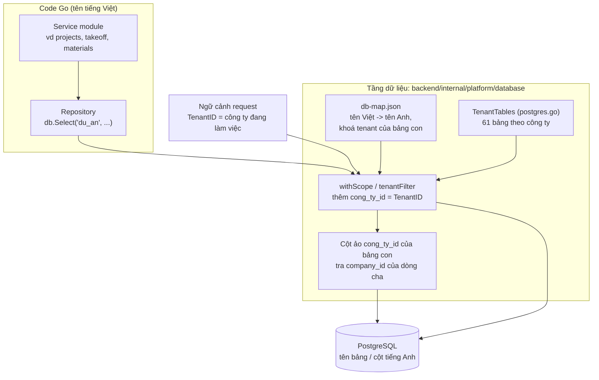
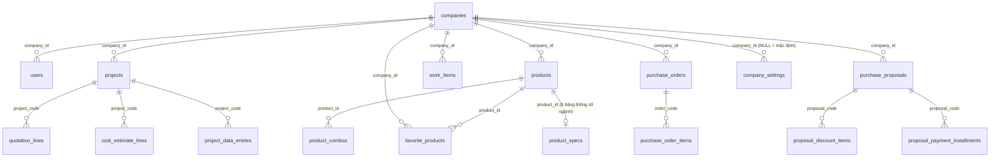
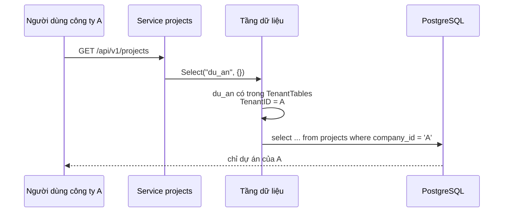
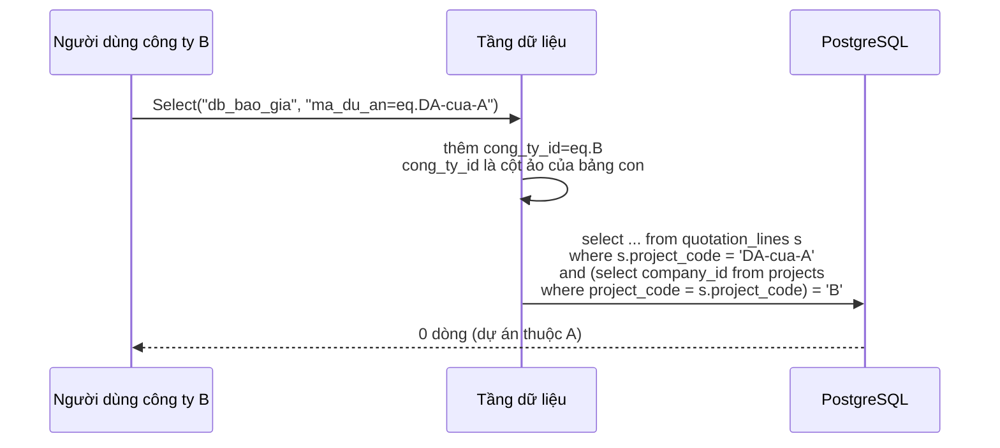
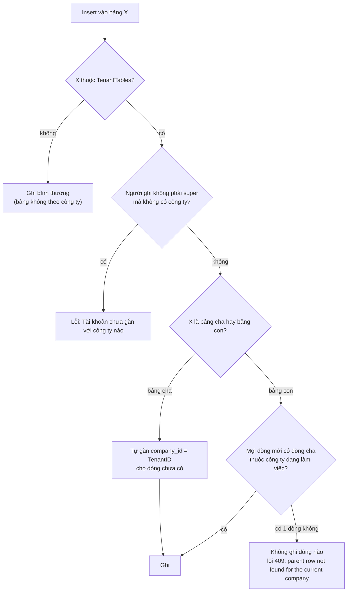

# Tách dữ liệu theo công ty (multi-tenant) - thiết kế database

Cách database và tầng dữ liệu bảo đảm công ty này không thấy, không sửa được dữ liệu công ty khác, lấy QS làm ví dụ. Đọc từ code và `infra/db/schema.sql` ngày 2026-11-18. Phần quyền người dùng xem [phan-quyen.md](../kien-truc/phan-quyen.md). Ví dụ từng câu SQL: [luong-truy-van-theo-cong-ty.md](luong-truy-van-theo-cong-ty.md).

## 1. Tóm tắt

- **Một database dùng chung cho mọi công ty.** Không có database hay schema riêng cho từng công ty.
- **Bảng cha có cột `company_id`** (khoá ngoại tới `companies`, `ON DELETE CASCADE`).
- **Bảng con không có `company_id`.** Công ty của dòng con lấy theo dòng cha (dòng bóc tách lấy theo dự án).
- **Việc lọc làm ở tầng dữ liệu của backend** (`backend/internal/platform/database`), không ở từng màn hình. Mọi truy vấn vào bảng có trong `TenantTables` tự thêm điều kiện công ty.
- **Database KHÔNG bật Row Level Security.** Lớp bảo vệ nằm ở code Go. Truy cập thẳng database (psql, script, SQL thô qua `DB.Pool()`) không bị lọc.

## 2. Ba lớp cấu thành

| Thành phần | Vai trò | File |
|---|---|---|
| `TenantID` | Công ty đang làm việc: Super đã chọn "Xem như công ty" thì là công ty đó, người khác là công ty của mình | `backend/internal/shared/tenant/tenant.go:36-45` |
| `TenantTables` | Danh sách bảng (tên trong code) phải lọc theo công ty | `backend/internal/platform/database/postgres.go:38-51` |
| `db-map.json` | Dịch tên bảng / cột; bảng con khai `tenant: {via, parent, key}` để biết dòng cha | `backend/internal/platform/database/db-map.json` |
| `withScope` | Thêm `cong_ty_id=eq.<TenantID>` vào điều kiện của Select / Update / Remove | `postgres.go:276-301` |
| Cột ảo | Bảng con: `cong_ty_id` được dịch thành truy vấn con lấy `company_id` của dòng cha | `backend/internal/platform/database/catalog.go:87-91`, `:183-189` |

## 3. Các bảng của QS

### Sơ đồ quan hệ

### Bảng cha (có `company_id`)

| Tên trong code | Bảng trong DB | Nội dung | Khoá / index liên quan công ty |
|---|---|---|---|
| `du_an` | `projects` | Dự án | `fk_projects_company_id`; `idx_projects_company_id_created_at`; `project_code` duy nhất toàn hệ thống |
| `db_san_pham` | `products` (+ view `product_catalog`) | Sản phẩm của công ty | Duy nhất theo (`company_id`, `product_code`, ...) |
| `db_san_pham_history` | `product_histories` | Lịch sử sửa sản phẩm | `company_id` |
| `sp_yeu_thich` | `favorite_products` | Sản phẩm yêu thích | Duy nhất (`company_id`, `product_id`) |
| `cong_tac` / `cong_tac_history` | `work_items` / `work_item_histories` | Công tác dự toán và lịch sử | `idx_work_items_company_id_...` |
| `don_mua_hang` | `purchase_orders` | Đơn mua hàng | `order_code` duy nhất; index (`company_id`, `sent_at`) |
| `de_xuat` | `purchase_proposals` | Đề xuất mua hàng | `proposal_code` duy nhất; index (`company_id`, `sent_at`) |
| `cai_dat_cong_ty` | `company_settings` | Cài đặt chung của công ty (mẫu báo giá, chi phí, Marketing `mkAds`, Kinh doanh `kdOptions`...) | Duy nhất (`company_id`, `setting_key`) với `NULLS NOT DISTINCT` |
| `yeu_cau_sua_du_an` | `project_edit_requests` | Yêu cầu sửa dự án | `company_id` |
| `delete_requests`, `notifications`, `audit_log` | cùng tên (`audit_logs`) | Yêu cầu xoá, thông báo, nhật ký | `company_id` |
| `users` | `users` | Tài khoản | `company_id`; tên đăng nhập duy nhất toàn hệ thống |

### Bảng con (không có `company_id`, lấy theo dòng cha)

| Tên trong code | Bảng trong DB | Dòng cha (`tenant` trong db-map) |
|---|---|---|
| `db_bao_gia` | `quotation_lines` (dòng bóc tách) | `projects` qua `project_code` |
| `khai_toan` | `cost_estimate_lines` (tờ bìa) | `projects` qua `project_code` |
| `du_an_data` | `project_data_entries` (dữ liệu riêng từng dự án) | `projects` qua `project_code` |
| `sp_combo` | `product_combos` | `products` qua `product_id` |
| `chi_tiet_mua_hang` | `purchase_order_items` | `purchase_orders` qua `order_code` |
| `chi_tiet_de_xuat_ck`, `chi_tiet_de_xuat_tt` | `proposal_discount_items`, `proposal_payment_installments` | `purchase_proposals` qua `proposal_code` |

Mọi bảng con có khoá ngoại tới bảng cha với `ON DELETE CASCADE`: xoá dự án thì dòng bóc tách, tờ bìa, dữ liệu dự án mất theo.

Bảng không theo công ty: `companies` (chính danh sách công ty) và `system_settings` (`cai_dat_he_thong`, cài đặt mặc định toàn hệ thống do Super quản lý).

## 4. Luồng đọc

### Bảng cha: đọc danh sách dự án

### Bảng con: đọc dòng bóc tách của một dự án

Biết mã dự án của công ty khác cũng không đọc được: điều kiện công ty luôn đi kèm.

## 5. Luồng ghi

- Bảng cha: `postgres.go:491-509`. Dòng đã có `company_id` thì giữ nguyên.
- Bảng con: một câu lệnh duy nhất, chỉ chèn khi mọi dòng có cha cùng công ty (`postgres.go:558-570`). Công ty B không thể chèn dòng bóc tách vào dự án của A.
- Sửa và xoá đi qua `withScope` như đọc: điều kiện công ty được thêm vào `where`, nên dòng của công ty khác không bị đụng tới.

## 6. Trường hợp đặc biệt

| Trường hợp | Cách làm | File |
|---|---|---|
| Super chưa chọn công ty | `TenantID` rỗng: không lọc, thấy toàn hệ thống | `shared/tenant/tenant.go:64-68` |
| Bỏ lọc có chủ đích (`NoScope: true`) | Chỉ dùng cho truy cập xuyên công ty thật sự: đăng nhập, phiên, Super quản lý công ty và tài khoản, báo cáo của Super, đọc gói tính năng của công ty | `modules/auth`, `companies`, `users`, `reports` (`postgres.go`) |
| Kho sản phẩm chung của Dezon | Công ty có `has_dezon_catalog_access` được đọc thêm sản phẩm có `company_id` = Dezon, chỉ đọc | `modules/materials/service_catalog.go:72-84` |
| Cài đặt công ty `__cty` | Dữ liệu dùng chung của công ty (vd `mkAds`, `kdOptions`) lưu trong `company_settings` theo `company_id`; Super chưa chọn công ty đọc dòng `company_id IS NULL` | `modules/projects/service_data.go`, `projects/postgres.go:84-95` |
| Sản phẩm nhiều ngành | Đọc qua view `product_catalog`; ghi tách vào `products` + 6 bảng `product_*_specs` (khoá `product_id`, công ty theo `products`) | `db-map.json` (`view`, `parts`) |
| Chat | Module `chat` viết SQL thô qua `DB.Pool()`; bảng `chat_*` không đi qua cơ chế lọc này | `backend/internal/modules/chat` |
| Xoá công ty | Khoá ngoại `company_id ... ON DELETE CASCADE` + thứ tự xoá bảng trong `tenantTablesOrder` | `modules/companies` |

## 7. Ràng buộc khi thêm bảng mới

1. Bảng theo công ty: có cột `company_id uuid` + khoá ngoại tới `companies(id) ON DELETE CASCADE` + index bắt đầu bằng `company_id`.
2. Thêm tên bảng (tên trong code) vào `TenantTables` (`postgres.go`). Quên bước này thì dữ liệu lộ sang công ty khác.
3. Bảng con không có `company_id`: khai `tenant: {via, parent, key}` trong `db-map.json` và cũng thêm vào `TenantTables`.
4. Thêm cặp tên `"ten_trong_code": "name_in_db"` vào `db-map.json`.
5. Thêm bảng vào thứ tự xoá khi xoá công ty (`tenantTablesOrder`, module `companies`).
6. Không dùng `NoScope` hay SQL thô cho dữ liệu của một công ty.

Quy tắc đầy đủ: [database-rules.md](database-rules.md).

## 8. Giới hạn của thiết kế

- **Không có Row Level Security trong PostgreSQL.** Mọi bảo vệ nằm ở code Go; một chỗ quên `TenantTables`, dùng sai `NoScope` hoặc SQL thô là lộ dữ liệu.
- **Mã dự án, mã đơn mua, mã đề xuất là duy nhất toàn hệ thống** (không phải theo công ty). Không gây lộ dữ liệu, nhưng hai công ty không dùng trùng một mã được.
- **Tên đăng nhập duy nhất toàn hệ thống.**
- **Bảng con tra công ty qua truy vấn con tới dòng cha.** Đúng nhưng tốn hơn lọc thẳng; cần index trên khoá nối (`project_code`, `product_id`...).
