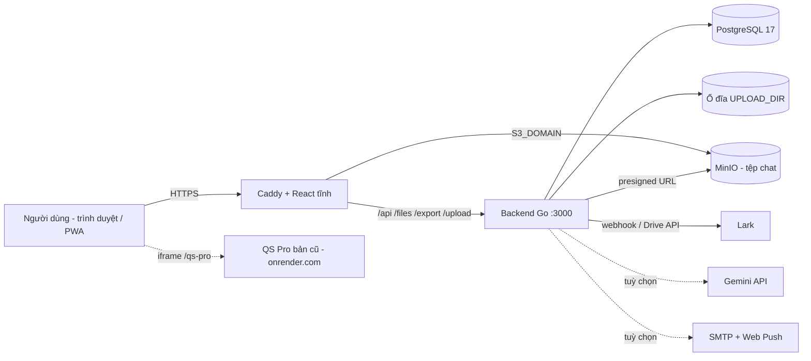
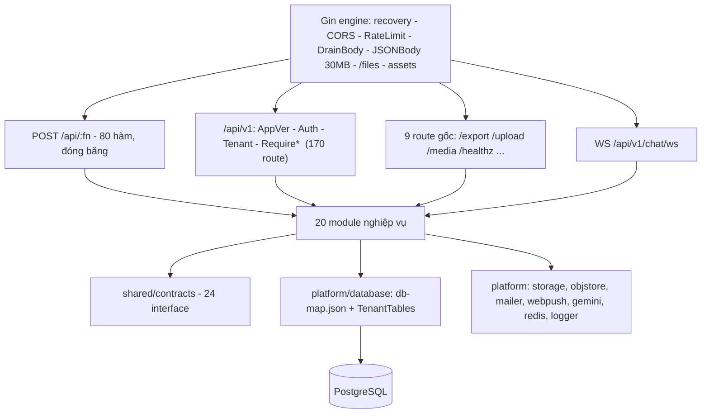
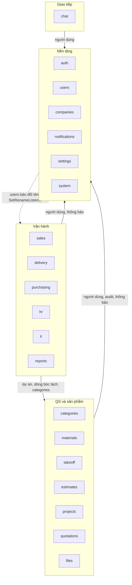
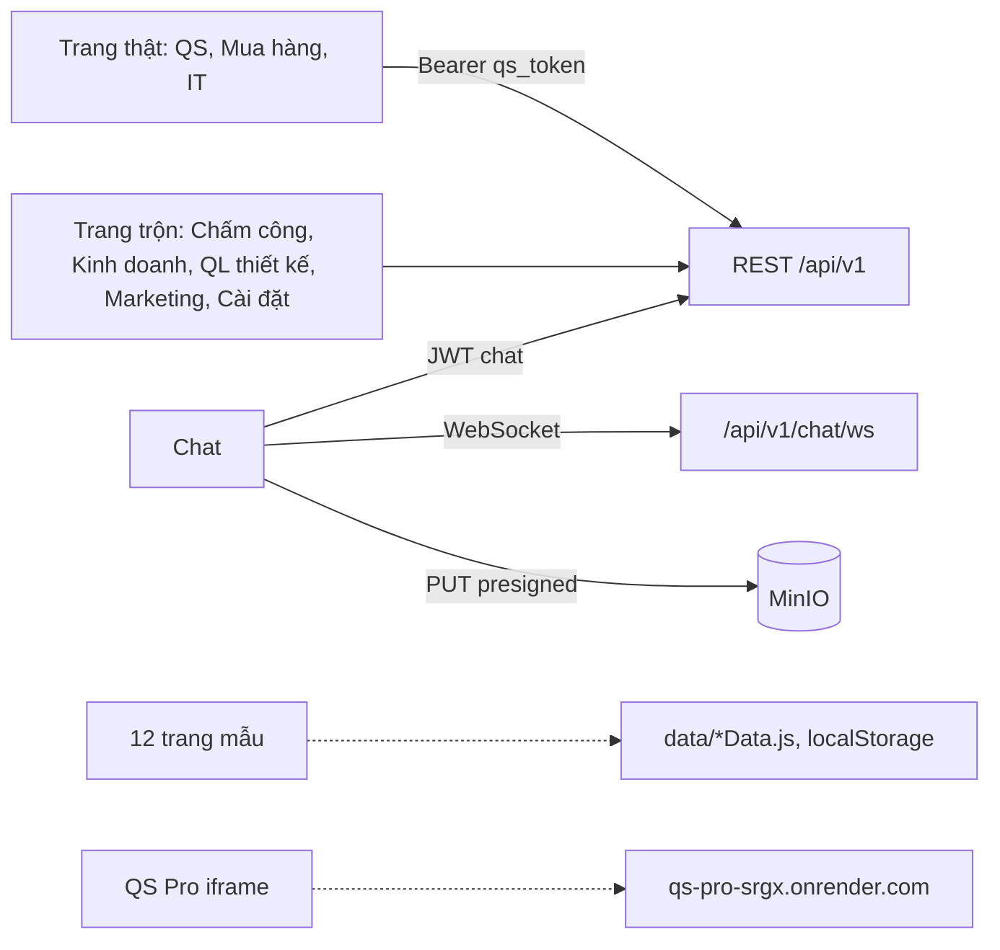
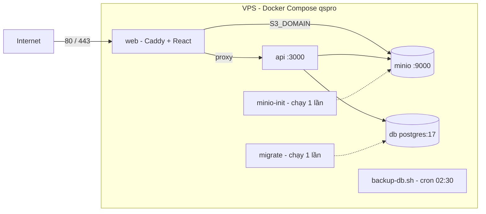

# Kiến trúc hệ thống QS Pro

| Mục | Giá trị |
|-----|---------|
| Cập nhật | 2026-11-26 |
| Commit | `782b792` (nhánh `thanhv5`) |
| Sinh bởi | `/architecture` - chạy lại lệnh để cập nhật, đừng sửa tay |
| Sơ đồ đẹp (HTML) | [docs/06-design/kien-truc/index.html](../../06-design/kien-truc/index.html) |

## 1. Tóm tắt

QS Pro gồm hai dự án tách rời: server Go + Gin (`backend/`) và giao diện React 18 + Vite (`frontend/`).
Production chạy trên một VPS CloudFly (https://pro.dezon.vn) bằng Docker Compose: Caddy vừa phục vụ file tĩnh React vừa chuyển tiếp `/api`, `/files`... sang server Go.
Dữ liệu nghiệp vụ nằm trong PostgreSQL 17 (82 bảng + 1 view), file ảnh / tài liệu trên ổ đĩa (`UPLOAD_DIR`), tệp chat trên MinIO.
Server có 20 module nghiệp vụ (80 hàm cổng cũ `/api/:fn` đóng băng + 170 route REST chỉ bản Go), gọi chéo qua 24 interface trong `shared/contracts`, nối tập trung trong `routes.go`.
Hệ thống ngoài: Lark (webhook + Drive API), Gemini (phân tích khách hàng Kinh doanh), SMTP và Web Push (chỉ cho chat) - tất cả tuỳ chọn.

## 2. Tổng quan (D1)

| Thành phần | Công nghệ | Vai trò | Bắt buộc / tuỳ chọn |
|---|---|---|---|
| Caddy (`web`) | caddy 2.10 | TLS Let's Encrypt, phục vụ React `/srv`, chuyển tiếp route backend, chuyển hướng tên miền phụ, tên miền riêng cho MinIO | Bắt buộc (`DOMAIN`, `WWW_DOMAIN`, `ACME_EMAIL`, `S3_DOMAIN`) |
| Backend Go (`api`) | Go 1.25, Gin | Toàn bộ nghiệp vụ, REST `/api/v1`, cổng cũ `/api/:fn`, WebSocket chat, job nền | Bắt buộc (`AUTH_SECRET`, `DATABASE_URL`) |
| PostgreSQL (`db`) | postgres:17-alpine | Dữ liệu nghiệp vụ, phiên đăng nhập | Bắt buộc. Thiếu `DATABASE_URL` server vẫn chạy nhưng `DB.Ok()` = false (`backend/internal/platform/database/postgres.go:225`) |
| Ổ đĩa uploads | volume `uploads` | Ảnh / tài liệu (tối đa 300 MB / file), phục vụ công khai ở `/files/*` | Luôn bật (`UPLOAD_DIR`, mặc định `uploads`, `backend/internal/config/config.go:92`) |
| MinIO (`minio`) | MinIO tự build từ mã nguồn | Tệp chat (ảnh, video, ghi âm) qua presigned URL | Tuỳ chọn ở backend (`CHAT_S3_ENDPOINT`, `config.go:143`); có sẵn trong compose |
| Gemini | HTTP `generativelanguage.googleapis.com` | Đề xuất / chat AI cho trang khách hàng Kinh doanh | Tuỳ chọn (`GEMINI_API_KEY`, `config.go:156`); trống = gợi ý theo quy tắc |
| Redis | - | Chia sẻ bộ đếm rate limit giữa nhiều tiến trình | Tuỳ chọn (`REDIS_URL`, `config.go:121`); KHÔNG có trong compose |
| Lark | HTTP | Thẻ đề xuất mua hàng, báo cáo SP mới, tải ảnh cũ trên Drive | Tuỳ chọn, xem mục 10 về webhook mặc định |
| SMTP, Web Push | net/smtp, VAPID | OTP email + thông báo đẩy của chat | Tuỳ chọn (`SMTP_HOST`, `CHAT_VAPID_*`, `config.go:135-142`) |

## 3. Backend (D2)

Tiến trình `cmd/api` (`backend/cmd/api/main.go:17`): đọc `.env` -> Redis (lỗi không dừng) -> `server.New` -> `jobs.Start` (`:32`) -> worker tin hẹn giờ của chat (`:35`) -> `srv.Run` (`:37`).
Hai lệnh phụ: `cmd/migrate` (chạy `infra/db/migrations`), `cmd/vapid` (sinh khoá Web Push).

**Đường đi của 1 request** (ví dụ `GET /api/v1/projects` từ trang QS):

1. Trình duyệt gọi `request()` trong `frontend/src/pages/QS/api/http.js:115`, gắn `Authorization: Bearer <qs_token>` (đọc localStorage mỗi lần, `http.js:37`, `:47`) và `x-view-company` nếu super đang "xem như" (`http.js:49`). URL = `VITE_API_URL + '/api/v1' + path` (`http.js:87`).
2. Caddy khớp `@backend` (`infra/deploy/Caddyfile:28`) và chuyển tiếp sang `api:3000`.
3. Chuỗi middleware chung chạy theo thứ tự trong `backend/internal/server/server.go:103-127`.
4. Nhóm `/api/v1` chạy `AppVer -> Auth -> Tenant` (`backend/internal/server/routes.go:79`). `Auth` không chặn; mỗi route tự gắn `RequireLogin` / `RequireAdmin` / `RequireSuper`.
5. Handler của module đọc tham số rồi gọi `Service`; service đọc / ghi qua `*database.DB`.
6. `platform/database` dịch tên tiếng Việt sang tiếng Anh theo `db-map.json` và tự thêm điều kiện `company_id` cho bảng có trong `TenantTables` (`backend/internal/platform/database/postgres.go:38`).
7. Kết quả trả về bằng gói `response` / `omap` (giữ thứ tự khoá), client bóc lớp `{result}`.

| Thứ tự | Middleware | Khi nào chạy | Ghi chú |
|---|---|---|---|
| 1 | `recovery()` | Luôn (`server.go:103`) | Panic -> 500 |
| 2 | `CORS` | Khi có `CORS_ORIGINS` (`:105`) | Danh sách này cũng là origin được phép của WebSocket (`routes.go:255`) |
| 3 | `RateLimit` | Khi `RATE_LIMIT_RPS > 0` (`:108`) | Theo IP, dùng Redis nếu có, không thì bộ nhớ |
| 4 | `DrainBody`, `JSONBody(30MB)` | Luôn (`:113-114`) | `JSONBodyLimit` ở `middleware/body.go:22`; file tài liệu `DocMaxMB = 300` (`body.go:26`) |
| 5 | `uploads` | Luôn (`:116`) | GET/HEAD `/files/*`, công khai, không kiểm phiên |
| 6 | `embeddedAssets` | Luôn (`:119`) | `/logo.svg`, `*-spec.js`, file mẫu `.xlsx` nhúng go:embed |
| 7 | `static` | Khi đặt `STATIC_DIR` (`:121-127`) | Giao diện cũ + `/vendor/*`, mặc định tắt |
| 8 | `AppVer -> Auth -> Tenant` | Nhóm `/api/v1` (`routes.go:79`) | Gắn actor + công ty vào context |
| - | `rpc.Handle` | `POST /api/:fn` | Tự giải actor, tự kiểm quyền theo Registry (`Login` / `Public` / `Admin` / `Super` / `SelfAuth`) |

Số hàm / route đóng băng vẫn đúng 80 / 80 / 9 (`backend/internal/server/wiring_test.go:82`, `:324`, `:117-131`).
Job nền chạy trong cùng tiến trình `cmd/api`, xem mục 8.

## 4. Module nghiệp vụ (D3)

Số liệu: Reg = hàm cổng cũ `/api/:fn`; Go = route REST chỉ bản Go (đếm cả route khai qua hàm phụ trong `chat`, `delivery`, `hr`). Dòng code không tính file test.

| Module | Nhóm | Làm gì | Reg / Go | Bảng chính (tên trong code) | Gọi module nào (qua contracts) | Dòng code |
|---|---|---|---|---|---|---|
| auth | Nền tảng | Đăng nhập, phiên, đổi mật khẩu, prefs | 6 / 0 | users, phien_dang_nhap | users, companies | ~1.1k |
| users | Nền tảng | Quản lý tài khoản, nhật ký hoạt động | 7 / 1 | users, audit_log, phong_ban | companies, auth, sales (3 setter, `users/service.go:32-34`) | ~1.3k |
| companies | Nền tảng | Công ty multi-tenant, nhắc gia hạn | 6 / 1 | cong_ty | users, notifications | ~1.0k |
| notifications | Nền tảng | Thông báo trong app (chuông) | 4 / 0 | notifications | users | ~0.4k |
| settings | Nền tảng | **Mới.** Cài đặt mặc định toàn hệ thống (giao diện, chung, hiển thị); super sửa, mọi người đọc | 0 / 2 | cai_dat_he_thong | - | ~0.3k |
| system | Nền tảng | Module khuôn mẫu, không có route | 0 / 0 | - | - | ~60 |
| categories | QS | Ngành hàng / hạng mục, nhãn - cột, file mẫu nhập | 0 / 2 | - (dữ liệu tĩnh `shared/specs`) | - | ~1.8k |
| materials | QS | Danh mục sản phẩm: CRUD, duyệt, combo, biến thể, nhập / xuất | 20 / 1 | db_san_pham, sp_combo, sp_yeu_thich, delete_requests | users, notifications, ổ đĩa (`DocUploader`); import gói `categories` | ~3.7k |
| takeoff | QS | Dòng bóc tách, công thức giá phía server | 6 / 0 | db_bao_gia | materials | ~0.5k |
| estimates | QS | Công tác xây dựng (phần thô) | 7 / 1 | cong_tac, cong_tac_history | materials, users | ~1.7k |
| projects | QS | Dự án, du_an_data, cài đặt công ty, yêu cầu sửa | 8 / 3 | du_an, du_an_data, cai_dat_cong_ty, yeu_cau_sua_du_an | materials, takeoff, users, notifications | ~1.3k |
| quotations | QS | Tờ bìa khái toán, xuất báo giá Excel kèm ảnh | 4 / 0 | khai_toan | takeoff, projects, files, ổ đĩa | ~3.5k |
| files | QS | Tải ảnh cũ trên Lark Drive (`GET /media`) | 0 / 0 (1 route gốc) | - | - (gọi Lark) | ~0.9k |
| sales | Vận hành | Kinh doanh: khách tiềm năng, chăm sóc, lịch hẹn, nhiệm vụ, chấm điểm, phân tích AI, khoá API chỉ đọc | 0 / 25 | kd_khach_hang, kd_cham_soc, kd_cham_diem, kd_lich_hen, kd_nhiem_vu_kh, kd_goi_y | users, takeoff, projects, delivery, notifications, Gemini | ~4.3k |
| delivery | Vận hành | Dự án triển khai (thiết kế / thi công) | 0 / 17 | tk_du_an, tk_giai_doan, tk_cong_viec, tk_thau_phu, tk_thanh_vien, tk_binh_luan | users, projects | ~1.5k |
| purchasing | Vận hành | Đơn mua hàng, đề xuất chiết khấu / thanh toán | 11 / 1 | don_mua_hang, de_xuat | notifications, users (+ webhook Lark) | ~1.4k |
| hr | Vận hành | Tổ chức, nhân sự, chấm công, đơn từ, lương, tuyển dụng, OKR, đào tạo | 0 / 35 | hr_* (22 bảng) | users | ~3.6k |
| it | Vận hành | **Mới.** Helpdesk IT (phiếu yêu cầu kèm ảnh) + thiết bị | 0 / 9 | it_yeu_cau, it_thiet_bi | users, notifications, ổ đĩa | ~1.0k |
| reports | Vận hành | Báo cáo SP nhập mới gửi Lark | 1 / 0 | db_san_pham, audit_log | - ; import gói `categories` | ~1.4k |
| chat | Giao tiếp | Nhắn tin: OTP, danh bạ, nhóm, media, ghim, hẹn giờ, QR, push, WebSocket | 0 / 72 | chat_* (16 bảng, SQL thô qua `DB.Pool()`) | users | ~13.4k |

Tổng: 80 hàm Reg, 170 route Go, ~44.1k dòng Go trong các module.
Nguồn: khối MODULE WIRING `backend/internal/server/routes.go:110-175` (`func (s *Server) modules()` ở `:114`). Chỉ `categories` được import trực tiếp (bởi `materials`, `reports`), đúng ngoại lệ trong `CLAUDE.md`.
Vòng `auth - users - companies` cắt bằng 2 setter (`routes.go:125-126`); `users -> sales` (báo đổi tên) gắn bằng `SetRenameListener` (`routes.go:148`); `chat - realtime hub` cắt bằng `SetGateway` (`routes.go:156`).

## 5. Frontend (D4)

Mọi route nằm sau `AppGate` (cổng đăng nhập, `frontend/src/App.jsx:34`); quyền từng trang kiểm trong `AppShell` theo `data/navigation.js`. Riêng `/qs-pro` nằm ngoài `AppShell` (không có sidebar) và dùng `PageGuard` (`App.jsx:36`).
Tổng: 25 đường dẫn + trang chủ, 22 trang: 4 thật, 5 trộn, 1 nhúng ngoài, 12 mẫu.

| Trang | Route | Thật / Mock | Gọi backend |
|---|---|---|---|
| QS | `/qs` | Thật | projects, takeoff, materials, estimates, quotations, purchasing, users, companies, notifications (poll 30 giây), reports, route gốc `/export/*`, `/upload/*` |
| MuaHang | `/mua-hang` | Thật | purchasing, projects, delivery (`pages/MuaHang/api.js:51-83`) |
| IT | `/it` | Thật (trước đây mẫu) | it: `/it/tickets`, `/it/staff`, `/it/assets` (`pages/IT/api.js:31-48`), poll 30 giây |
| Chat | `/chat`, `/chat/join/:token`, `/chat/qr` | Thật (bot Dezbot dùng dữ liệu mẫu) | chat (REST + WebSocket), MinIO trực tiếp |
| ChamCong | `/cham-cong` | Trộn (tab Bảng lương, Hành chính, Tuyển dụng còn mẫu) | hr |
| KinhDoanh | `/kinh-doanh/:leadId?` | Trộn (một số phần lưu localStorage, `services/kdRequestService`) | sales (`/sales/leads`, `/staff`, `/appointments`, `/tasks`, `/ai-config`), file tải lên |
| QuanLyThietKe | `/quan-ly-thiet-ke` | Trộn (Gantt, Setup, PurchaseBoard còn mẫu) | delivery |
| Marketing | `/marketing` | Trộn (chỉ Chi tiêu quảng cáo gọi server) | projects (`du_an_data`), users, sales |
| CaiDat | `/cai-dat` | Trộn (Tài khoản + thanh mặc định hệ thống gọi server) | auth, settings (`/system-defaults`) |
| QSPro | `/qs-pro` | Nhúng ngoài | iframe tới bản cũ trên onrender.com |
| Dashboard, DuAn, TaiChinh, BIM, SanXuat, RD, Wiki, Lich, BanLamViec | `/`, `/du-an`, `/tai-chinh`, `/bim`, `/san-xuat`, `/rd`, `/wiki`, `/lich`, `/ban-lam-viec` | Mock | - |
| Gantt, NhiemVu, ChamCongMobile | `/gantt`, `/nhiem-vu`, `/cham-cong-mobile` | Mock (dữ liệu viết thẳng trong file) | - |

Phiên và trạng thái:
- `services/workSession.js` là phiên chung của app (dùng chung `qs_token`, không tải bootstrap 4 MB của QS), quyết định quyền trang / tab.
- QS dùng store ngoài React `pages/QS/state/store.js`; lần tải đầu gọi `/bootstrap` (`pages/QS/api/qsApi.js:35`). **Mới:** hiện ngay từ bản đệm IndexedDB `qs-cache` (`pages/QS/state/bootCache.js:5`, `store.js:261-271`) rồi đồng bộ ở nền; xoá đệm khi đăng xuất.
- Cài đặt mặc định hệ thống tải qua `services/systemDefaultsService.js:44` cho mọi trang.
- Chat có token riêng (JWT + refresh trong localStorage), đổi từ `qs_token`.
- WebSocket: `pages/Chat/api/chatSocket.js:100` (ping 25 giây). Service worker push: `/chat-sw.js` (`pages/Chat/state/chatStore.js:2636`).
- Không gọi Gemini hay Google Maps SDK từ trình duyệt; Google Maps chỉ là link ngoài (`pages/KinhDoanh/components/LeadModal.jsx:628`).

## 6. Dữ liệu

PostgreSQL schema `public`: 82 bảng + 1 view `product_catalog` (`infra/db/schema.sql:7569`). Schema `quarantine`: 10 bảng cách ly dữ liệu sai.
Migration: 52 file, `0001_dealer_price_generated.sql` đến `0054_sales_lead_dashboard_checks.sql` (không có số 0051, 0052).

| Nhóm | Số bảng | Bảng (tên DB) | Quan hệ chính ra ngoài nhóm |
|---|---|---|---|
| Lõi | 9 | companies, company_settings, users, user_sessions, audit_logs, notifications, delete_requests, system_settings, schema_migrations | Gốc: hầu hết bảng có `company_id -> companies.id`; `system_settings` dùng chung toàn hệ thống |
| QS - sản phẩm | 10 | products, product_histories, product_combos, favorite_products, 6 bảng `product_*_specs` | `product_id -> products.id`; view `product_catalog` = products + 6 bảng specs |
| QS - dự án | 6 (+1) | projects, project_data_entries, quotation_lines, cost_estimate_lines, work_items, work_item_histories (+ project_edit_requests chỉ có trong migration 0037) | `project_code -> projects` |
| Mua hàng | 5 | purchase_orders, purchase_order_items, purchase_proposals, proposal_discount_items, proposal_payment_installments | `requester_id -> users.id` |
| Kinh doanh | 6 | sales_leads, sales_lead_activities, sales_lead_scores, sales_lead_appointments, sales_lead_tasks, sales_lead_insights | `sales_leads.project_code -> projects`; bảng con `-> sales_leads.id` (cascade) |
| Triển khai | 6 | delivery_projects, delivery_project_members, delivery_subcontractors, delivery_phases, delivery_tasks, delivery_task_comments | `delivery_projects.lead_id -> sales_leads`, `.project_code -> projects` |
| HR | 22 | hr_org_units, hr_employees, hr_attendance_logs, hr_payroll_runs, hr_candidates... | `hr_employees.user_id -> users.id` |
| IT | 2 | it_tickets, it_assets | `company_id -> companies`, `created_by -> users` |
| Chat | 16 | chat_users, chat_conversations, chat_messages, chat_media, chat_scheduled_messages... | Không có khoá ra ngoài; `chat_users.qs_user_id` / `qs_company_id` cố ý không đặt khoá |

Lọc theo công ty: 29 bảng có cột `company_id` trong `schema.sql`; `TenantTables` có 57 tên trong code (`backend/internal/platform/database/postgres.go:38-51`); 27 bảng con lấy công ty qua bảng cha (khoá `tenant` trong `db-map.json`); bảng `chat_*` và `system_settings` không lọc theo công ty. Mọi bảng theo công ty mới từ 0047 đến 0054 đã có trong `TenantTables`.
Chi tiết cột: [schema-hien-hanh.md](../database/schema-hien-hanh.md).

## 7. Triển khai (D5)

| Container | Image / build | Cổng | Volume | Ghi chú |
|---|---|---|---|---|
| web | `infra/docker/frontend.Dockerfile` (node 22 build -> caddy 2.10) | 80, 443, 443/udp | caddy_data, caddy_config, Caddyfile (mount) | `VITE_API_URL` nạp lúc build: đổi tên miền phải build lại. `WWW_DOMAIN` (vd `dezon.tech www.dezon.tech`) chuyển hướng về `DOMAIN` (`Caddyfile:9-15`) |
| api | `infra/docker/backend.Dockerfile` (golang 1.25 -> alpine 3.22) | không mở ra host | uploads | Chờ db, migrate, minio, minio-init; healthcheck `/healthz` (`docker-compose.yml:117-129`) |
| migrate | dùng lại image api, `/app/qspro-migrate` | - | - | Chạy xong thoát; lỗi thì deploy dừng, bản cũ vẫn chạy |
| db | postgres:17-alpine | `127.0.0.1:5432` (chỉ qua SSH tunnel) | pgdata | Lần đầu nạp `infra/db/schema.sql` (`docker-compose.yml:28-29`) |
| minio | `infra/docker/minio.Dockerfile` (build từ mã nguồn) | console `127.0.0.1:9001` | minio_data | API 9000 chỉ ra ngoài qua Caddy `S3_DOMAIN` |
| minio-init | cùng image minio | - | - | Tạo bucket riêng tư, user ứng dụng, xoá `chat/in/` sau 1 ngày |

Sao lưu: `infra/scripts/backup-db.sh` chạy cron 02:30 hằng ngày (`infra/deploy/setup-server.sh:77`) và mỗi lần deploy (`infra/deploy/deploy.sh:45`), gồm `pg_dump`, tar thư mục uploads, `mc mirror` MinIO; giữ 14 ngày (`BACKUP_KEEP_DAYS`).
Script mới `infra/scripts/migrate-supabase-files.sh`: chuyển ảnh / tài liệu từ Supabase Storage cũ về volume uploads và sửa link trong DB (chế độ `scan` / `download` / `rewrite`).
Thao tác: [trien-khai-vps-cloudfly.md](../../04-van-hanh/trien-khai-vps-cloudfly.md).

## 8. Tích hợp ngoài & job nền

| Hệ thống / Job | Dùng để | Bật bằng | File |
|---|---|---|---|
| Lark webhook mua hàng | Thẻ đơn mua / đề xuất | `PURCHASE_WEBHOOK` (rỗng = webhook mặc định ghi trong code) | `backend/internal/modules/purchasing/service_send.go` |
| Lark webhook báo cáo | Báo cáo SP nhập mới | `REPORT_WEBHOOK`, không có thì dùng `PURCHASE_WEBHOOK` | `backend/internal/modules/reports/service.go` |
| Lark Drive API | Tải ảnh cũ cho `/media` và báo giá | `LARK_APP_ID`, `LARK_APP_SECRET`, `LARK_DOMAIN` | `backend/internal/modules/files/service.go:151` |
| Gemini | Đề xuất / chat AI trang khách hàng Kinh doanh; chọn model theo công ty | `GEMINI_API_KEY`, `GEMINI_MODEL` | `backend/internal/platform/gemini/gemini.go`, `backend/internal/modules/sales/service_insight.go` |
| Khoá API chỉ đọc Kinh doanh | Hệ thống ngoài đọc `GET /sales/leads`, `/sales/staff` | `SALES_READ_KEYS` (`ten:cong_ty_id:sha256`) | `backend/internal/modules/sales/apikey.go` |
| SMTP | OTP email của chat | `SMTP_HOST` (rỗng = ghi OTP vào log) | `backend/internal/platform/mailer/` |
| Web Push | Thông báo đẩy chat | đủ 3 biến `CHAT_VAPID_*` (sinh bằng `go run ./cmd/vapid`) | `backend/internal/platform/webpush/` |
| MinIO / S3 | Tệp chat | `CHAT_S3_ENDPOINT` + khoá | `backend/internal/platform/objstore/` |
| Redis | Rate limit dùng chung | `REDIS_URL` | `backend/internal/platform/redis/` |
| Job báo cáo SP mới | Gửi Lark thứ 4 và thứ 7 lúc 08:00 giờ VN, chạy bù 70 giây sau khởi động | `REPORT_JOB` (chỉ `0` mới tắt) | `backend/internal/jobs/worker.go:37-48` |
| Job nhắc gia hạn công ty | Hằng ngày 08:05, chỉ gửi chuông trong app cho admin | `REPORT_JOB` | `backend/internal/jobs/worker.go:42-43`, `backend/internal/modules/companies/expiry.go` |
| Worker tin hẹn giờ chat | Gửi tin nhắn hẹn giờ, quét mỗi 15 giây | Luôn bật (không theo `REPORT_JOB`) | `backend/internal/modules/chat/service_scheduled.go:25`, `backend/cmd/api/main.go:35` |

## 9. Thay đổi so với lần quét trước

So với `c84abd2` (2026-11-14), 61 commit:
- **Module 18 -> 20:** thêm `it` (helpdesk IT + thiết bị, migration 0048) và `settings` (cài đặt mặc định hệ thống, migration 0047).
- **Dịch vụ nền mới `platform/gemini`**, chỉ `sales` dùng; compose truyền thêm `GEMINI_API_KEY`, `GEMINI_MODEL`, `SALES_READ_KEYS` (`infra/deploy/docker-compose.yml:76-88`).
- **Kinh doanh lớn lên nhiều:** `sales` 6 -> 25 route (chấm điểm, lịch hẹn, nhiệm vụ, gợi ý AI, cấu hình AI, khoá API chỉ đọc); 4 bảng mới `sales_lead_scores`, `_appointments`, `_tasks`, `_insights` (0053-0054). Route giao diện thành `/kinh-doanh/:leadId?`.
- `hr` 17 -> 35 route; `chat` 68 -> 72 route (tin hẹn giờ, bảng `chat_scheduled_messages`, migration 0049). `contracts` 20 -> 24 interface (thêm `DeliveryFromLead`, `UserRenameListener`, `DocUploader`, `TempFile`...).
- **Bảng 74 -> 82, migration 46 -> 52** (0047-0050, 0053-0054; cột `projects.platform` ở 0050).
- **Giao diện:** trang IT chuyển từ mẫu sang dữ liệu thật; Cài đặt đọc / ghi `/system-defaults`; QS hiện ngay từ bản đệm IndexedDB.
- **Triển khai:** tên miền chính `pro.dezon.vn`, `WWW_DOMAIN` nhận nhiều tên miền phụ và chuyển hướng; Caddy thêm `/gach-spec.js`; tải tài liệu tối đa 300 MB ghi thẳng xuống đĩa; script `migrate-supabase-files.sh`.

## 10. Điểm đáng chú ý

- **Webhook Lark thật vẫn là mặc định.** `DefaultPurchaseWebhook` ghi cứng ở `backend/internal/config/config.go:90`; compose truyền `${PURCHASE_WEBHOOK:-}` (`infra/deploy/docker-compose.yml:64`), nên nếu `.env` của VPS không đặt biến, mua hàng và báo cáo gửi vào nhóm Lark mặc định.
- **`AUTH_SECRET` vẫn có mặc định** `qs-pro-dev-secret-change-me` (`config.go:88`), không có chốt chặn trong Go. Compose bắt buộc biến này (`docker-compose.yml:63`), nhưng chạy tay mà thiếu thì không báo.
- **`infra/db/schema.sql` vẫn lệch migration:** thiếu 0036-0039 (bảng `project_edit_requests`, các cột architect / studio... của `projects`), 0050 (`projects.platform`) và 2 ràng buộc CHECK của 0054; bảng của 0053 nằm cuối file (`schema.sql:13061`), có vẻ chép tay thay vì sinh lại bằng `pg_dump`. Container `db` nạp file này khi volume trống (`docker-compose.yml:28-29`), nên VPS mới có thể khởi tạo thiếu (chưa xác minh migrate có tự bù không).
- **Lệch con số trong chú thích:** Caddyfile ghi backend giới hạn "file 50 MB" (`infra/deploy/Caddyfile:30`) nhưng `DocMaxMB = 300` (`backend/internal/middleware/body.go:26`); model Gemini mặc định trong code là `gemini-3.8-flash` (`config.go:93`) còn chú thích compose ghi `gemini-2.5-flash` (`docker-compose.yml:86`).
- **Số migration nhảy từ 0050 lên 0053** (không có 0051, 0052). Migrate kiểm checksum theo file nên chạy được, nhưng nên ghi rõ lý do để tránh ai đó tạo lại 0051.
- **Phụ thuộc ngược Nền tảng -> Vận hành:** `users` gọi `sales` khi đổi tên người dùng qua setter (`backend/internal/server/routes.go:148`). Đúng khuôn contracts, nhưng là chỗ duy nhất module nền biết tới module nghiệp vụ.
- **`/files/*` công khai**: middleware `uploads` chạy trước mọi route và không kiểm phiên (`backend/internal/server/server.go:116`). Ảnh phiếu IT (`/files/it/...`) cũng thuộc diện này.
- **12 trên 22 trang còn dữ liệu mẫu**, cộng 5 trang trộn; `/qs-pro` vẫn nhúng bản cũ trên onrender.com (`frontend/src/pages/QSPro/QSPro.jsx:14`).
- **Chat chưa nối SMS và quét virus**: `Deps.SMS`, `Deps.Scan` không được truyền trong MODULE WIRING (`backend/internal/modules/chat/service.go:65`, `:71`), nên OTP SMS chỉ ghi log và tệp tải lên coi như sạch.
- **Module lớn nhất vẫn là chat** (~13.4k trên ~44.1k dòng Go của các module); `frontend/src/pages/Chat/state/chatStore.js` có 2908 dòng. `contracts.ProductLister` vẫn chỉ được `materials` cài mà không ai dùng (`backend/internal/modules/materials/service.go:69`).
- **Production không có Redis** (rate limit đếm trong bộ nhớ); bản mirror MinIO trong sao lưu không bị dọn theo `BACKUP_KEEP_DAYS` (`infra/scripts/backup-db.sh:44-60`).
