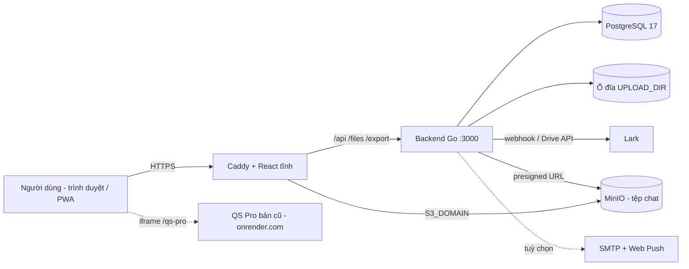
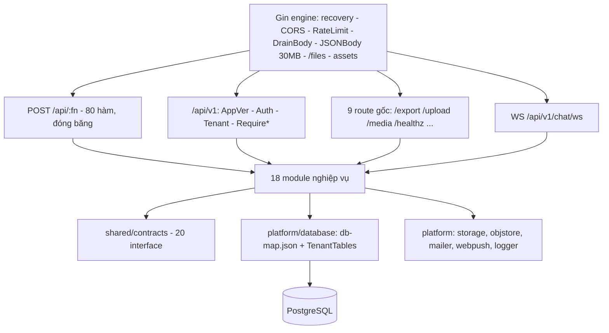
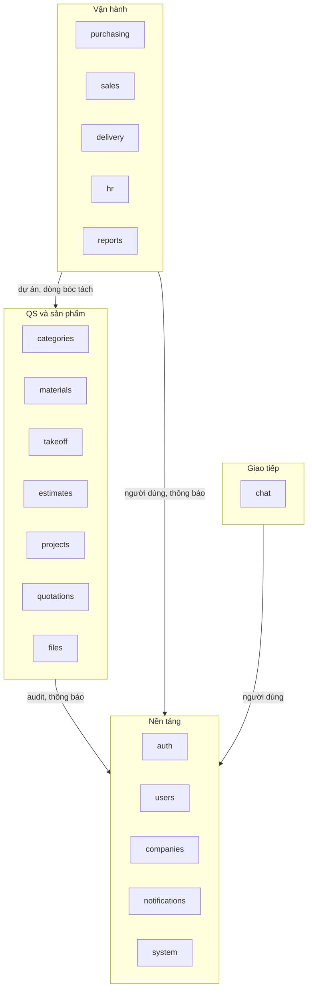
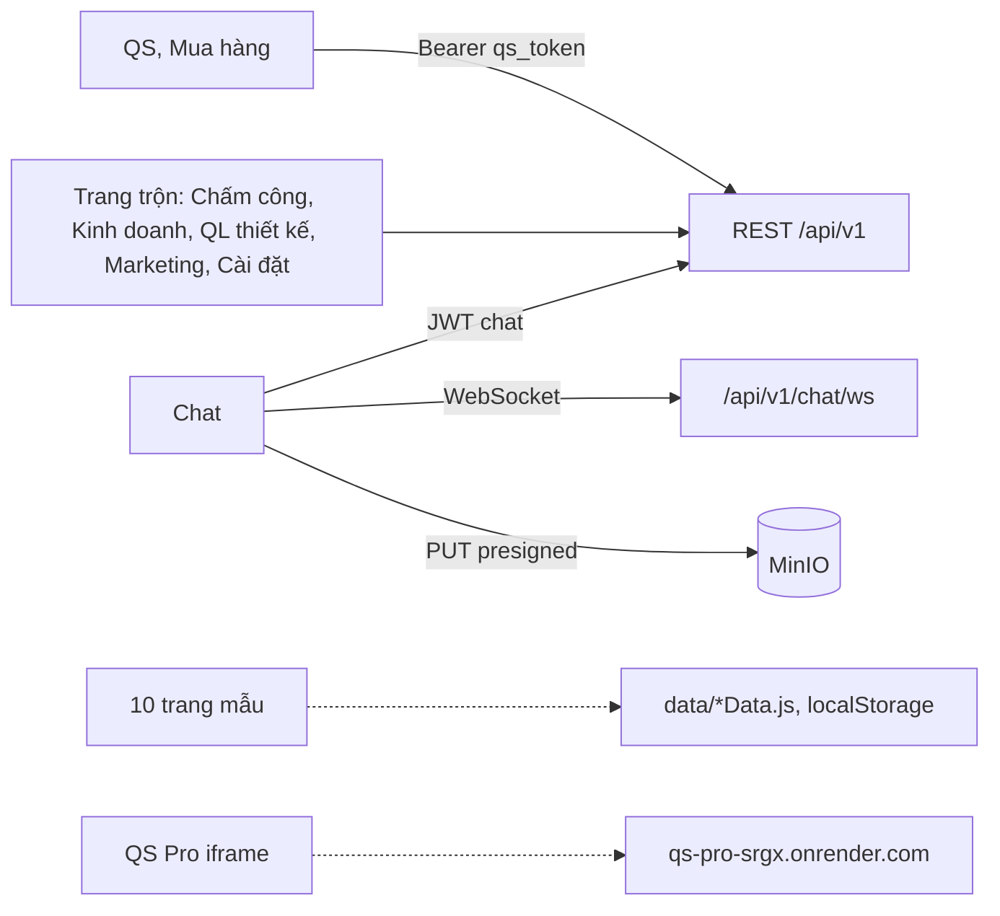
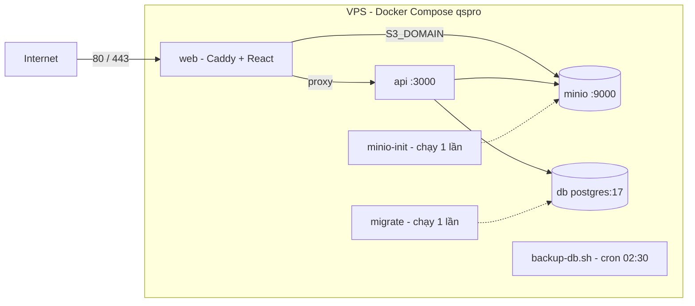

# Kiến trúc hệ thống QS Pro

| Mục | Giá trị |
|-----|---------|
| Cập nhật | 2026-11-14 |
| Commit | `c84abd2` (nhánh `src_N`) |
| Sinh bởi | `/architecture` - chạy lại lệnh để cập nhật, đừng sửa tay |
| Sơ đồ đẹp (HTML) | [docs/06-design/kien-truc/index.html](../../06-design/kien-truc/index.html) |

## 1. Tóm tắt

QS Pro gồm hai dự án tách rời: server Go + Gin (`backend/`) và giao diện React 18 + Vite (`frontend/`).
Production chạy trên một VPS bằng Docker Compose: Caddy vừa phục vụ file tĩnh React vừa chuyển tiếp `/api`, `/files`... sang server Go.
Dữ liệu nghiệp vụ nằm trong PostgreSQL 17 (74 bảng + 1 view), file ảnh / tài liệu trên ổ đĩa (`UPLOAD_DIR`), tệp chat trên MinIO.
Server có 18 module nghiệp vụ, gọi chéo nhau chỉ qua interface trong `shared/contracts`, nối tập trung trong `routes.go`.
Hệ thống ngoài: Lark (webhook + Drive API), SMTP và Web Push (chỉ cho chat, tuỳ chọn).

## 2. Tổng quan (D1)

| Thành phần | Công nghệ | Vai trò | Bắt buộc / tuỳ chọn |
|---|---|---|---|
| Caddy (`web`) | caddy 2.10 | TLS Let's Encrypt, phục vụ React `/srv`, chuyển tiếp route backend, tên miền riêng cho MinIO | Bắt buộc (`DOMAIN`, `ACME_EMAIL`, `S3_DOMAIN`) |
| Backend Go (`api`) | Go 1.25, Gin | Toàn bộ nghiệp vụ, REST `/api/v1`, cổng cũ `/api/:fn`, WebSocket chat | Bắt buộc (`AUTH_SECRET`, `DATABASE_URL`) |
| PostgreSQL (`db`) | postgres:17-alpine | Dữ liệu nghiệp vụ, phiên đăng nhập | Bắt buộc. Server vẫn khởi động khi thiếu, nhưng mọi truy vấn báo "Chưa cấu hình DATABASE_URL" |
| Ổ đĩa uploads | volume `uploads` | Ảnh / tài liệu, phục vụ công khai ở `/files/*` | Luôn bật (`UPLOAD_DIR`, mặc định `uploads`) |
| MinIO (`minio`) | MinIO tự build | Tệp chat (ảnh, video, ghi âm) qua presigned URL | Tuỳ chọn ở backend (`CHAT_S3_ENDPOINT`, thiếu thì `MEDIA_DISABLED`); bắt buộc trong compose |
| Redis | - | Chia sẻ bộ đếm rate limit giữa nhiều tiến trình | Tuỳ chọn (`REDIS_URL`); KHÔNG có trong compose, production đếm trong bộ nhớ |
| Lark | HTTP | Thẻ đề xuất mua hàng, báo cáo SP mới, tải ảnh cũ trên Drive | Tuỳ chọn, xem mục 10 về webhook mặc định |
| SMTP, Web Push | net/smtp, VAPID | OTP email + thông báo đẩy của chat | Tuỳ chọn (`SMTP_HOST`, `CHAT_VAPID_*`) |

## 3. Backend (D2)

**Đường đi của 1 request** (ví dụ `GET /api/v1/projects` từ trang QS):

1. Trình duyệt gọi `request()` trong `frontend/src/pages/QS/api/http.js`, gắn `Authorization: Bearer <qs_token>` (đọc localStorage mỗi lần, `http.js:37`) và `x-view-company` nếu super đang "xem như" (`http.js:49`).
2. Caddy khớp `@backend` (`infra/deploy/Caddyfile:27`) và chuyển tiếp sang `api:3000`.
3. Chuỗi middleware chung chạy theo thứ tự trong `backend/internal/server/server.go:102-118`.
4. Nhóm `/api/v1` chạy `AppVer -> Auth -> Tenant` (`backend/internal/server/routes.go:76`). `Auth` không chặn; mỗi route tự gắn `RequireLogin` / `RequireAdmin` / `RequireSuper`.
5. Handler của module đọc tham số rồi gọi `Service`; service đọc / ghi qua `*database.DB`.
6. `platform/database` dịch tên tiếng Việt sang tiếng Anh theo `db-map.json` và tự thêm điều kiện `company_id` cho bảng có trong `TenantTables` (`backend/internal/platform/database/postgres.go:38`).
7. Kết quả trả về bằng gói `response` / `omap` (giữ thứ tự khoá), client bóc lớp `{result}`.

| Thứ tự | Middleware | Khi nào chạy | Ghi chú |
|---|---|---|---|
| 1 | `recovery()` | Luôn | Panic -> 500 HTML |
| 2 | `CORS` | Khi có `CORS_ORIGINS` | Danh sách này cũng là origin được phép của WebSocket |
| 3 | `RateLimit` | Khi `RATE_LIMIT_RPS > 0` | Theo IP, dùng Redis nếu có, không thì bộ nhớ |
| 4 | `DrainBody`, `JSONBody(30MB)` | Luôn | Giới hạn thân request JSON |
| 5 | `uploads` | Luôn | GET/HEAD `/files/*`, công khai, không kiểm phiên |
| 6 | `embeddedAssets` | Luôn | `/logo.svg`, `*-spec.js`, file mẫu `.xlsx` nhúng go:embed |
| 7 | `AppVer -> Auth -> Tenant` | Nhóm `/api/v1` | Gắn actor + công ty vào context |
| - | `rpc.Handle` | `POST /api/:fn` | Tự giải actor, tự kiểm quyền theo Registry (`Login` / `Public` / `Admin` / `Super`) |

Job nền (`backend/internal/jobs/worker.go`) chạy trong cùng tiến trình `cmd/api`, xem mục 8.

## 4. Module nghiệp vụ (D3)

Số liệu: Reg = hàm cổng cũ `/api/:fn`; Go = route REST chỉ bản Go. Dòng code không tính file test.

| Module | Nhóm | Làm gì | Reg / Go | Bảng chính (tên trong code) | Gọi module nào (qua contracts) | Dòng code |
|---|---|---|---|---|---|---|
| auth | Nền tảng | Đăng nhập, phiên, đổi mật khẩu, prefs | 6 / 0 | users, phien_dang_nhap | users, companies | ~1.1k |
| users | Nền tảng | Quản lý tài khoản, nhật ký hoạt động | 7 / 1 | users, audit_log, phong_ban | companies, auth (gắn sau khi dựng) | ~1.3k |
| companies | Nền tảng | Công ty multi-tenant, nhắc gia hạn | 6 / 1 | cong_ty | users, notifications | ~1.0k |
| notifications | Nền tảng | Thông báo trong app (chuông) | 4 / 0 | notifications | users | ~0.4k |
| system | Nền tảng | Module khuôn mẫu, không có route | 0 / 0 | - | - | ~60 |
| categories | QS | Ngành hàng / hạng mục, nhãn - cột, file mẫu nhập | 0 / 2 | - (dựa trên `shared/specs`) | - | ~1.8k |
| materials | QS | Danh mục sản phẩm: CRUD, duyệt, combo, nhập / xuất | 20 / 1 | db_san_pham, sp_combo, sp_yeu_thich, delete_requests | users, notifications, ổ đĩa (`Uploader`); import gói `categories` | ~3.6k |
| takeoff | QS | Dòng bóc tách, công thức giá phía server | 6 / 0 | db_bao_gia | materials | ~0.5k |
| estimates | QS | Công tác xây dựng (phần thô) | 7 / 1 | cong_tac, cong_tac_history | materials, users | ~1.7k |
| projects | QS | Dự án, du_an_data, cài đặt công ty, yêu cầu sửa | 8 / 3 | du_an, du_an_data, cai_dat_cong_ty, yeu_cau_sua_du_an | materials, takeoff, users, notifications | ~1.3k |
| quotations | QS | Tờ bìa khái toán, xuất báo giá Excel kèm ảnh | 4 / 0 | khai_toan | takeoff, projects, files, ổ đĩa | ~3.5k |
| files | QS | Tải ảnh cũ trên Lark Drive (`GET /media`) | 0 / 0 (1 route gốc) | - | - | ~0.9k |
| purchasing | Vận hành | Đơn mua hàng, đề xuất chiết khấu / thanh toán | 11 / 1 | don_mua_hang, de_xuat, chi_tiet_* | notifications, users | ~1.4k |
| sales | Vận hành | Kinh doanh: khách tiềm năng + chăm sóc | 0 / 6 | kd_khach_hang, kd_cham_soc | users, takeoff, projects, delivery | ~0.8k |
| delivery | Vận hành | Dự án triển khai (thiết kế / thi công) | 0 / 17 | tk_du_an, tk_giai_doan, tk_cong_viec... | users, projects | ~1.5k |
| hr | Vận hành | Tổ chức, nhân sự, chấm công, lương, tuyển dụng | 0 / 17 | hr_* (22 bảng) | users | ~3.6k |
| reports | Vận hành | Báo cáo SP nhập mới gửi Lark | 1 / 0 | db_san_pham, audit_log | - ; import gói `categories` | ~1.4k |
| chat | Giao tiếp | Nhắn tin: OTP, danh bạ, nhóm, media, push, WebSocket | 0 / 68 | chat_* (15 bảng, SQL thô) | users | ~12.9k |

Nguồn: khối MODULE WIRING `backend/internal/server/routes.go:111`. Chỉ `categories` được import trực tiếp (bởi `materials`, `reports`), đúng ngoại lệ trong `CLAUDE.md`. Vòng `auth - users - companies` được cắt bằng setter gắn sau khi dựng.

## 5. Frontend (D4)

Mọi route nằm sau `AppGate` (cổng đăng nhập) và `PageGuard` (kiểm quyền theo `data/navigation.js`). Riêng `/qs-pro` nằm ngoài `AppShell` nên không có sidebar.

| Trang | Route | Thật / Mock | Gọi backend |
|---|---|---|---|
| QS | `/qs` | Thật | projects, takeoff, materials, estimates, quotations, purchasing, users, companies, notifications (poll 30 giây), reports, route gốc `/export/*`, `/upload/file` |
| MuaHang | `/mua-hang` | Thật | purchasing, projects, delivery |
| Chat | `/chat`, `/chat/join/:token`, `/chat/qr` | Thật (bot Dezbot dùng dữ liệu mẫu) | chat (REST + WebSocket), MinIO trực tiếp |
| ChamCong | `/cham-cong` | Trộn (tab Bảng lương, Hành chính, Tuyển dụng còn mẫu) | hr |
| KinhDoanh | `/kinh-doanh` | Trộn | sales, projects (`du_an_data`) |
| QuanLyThietKe | `/quan-ly-thiet-ke` | Trộn | delivery |
| Marketing | `/marketing` | Trộn | sales, users, projects (`du_an_data`) |
| CaiDat | `/cai-dat` | Trộn (chỉ tab Tài khoản gọi server) | auth |
| QSPro | `/qs-pro` | Nhúng ngoài | iframe tới bản cũ trên onrender.com |
| IT | `/it` | Mock (phiếu lưu localStorage) | - |
| Dashboard, DuAn, TaiChinh, BIM, SanXuat, RD, Wiki, Lich, BanLamViec | `/`, `/du-an`, `/tai-chinh`, `/bim`, `/san-xuat`, `/rd`, `/wiki`, `/lich`, `/ban-lam-viec` | Mock | - |
| Gantt, NhiemVu, ChamCongMobile | `/gantt`, `/nhiem-vu`, `/cham-cong-mobile` | Mock (dữ liệu viết thẳng trong file), không có trên menu | - |

Phiên và trạng thái:
- `services/workSession.js` là phiên duy nhất của app (`useSyncExternalStore`), quyết định `canPage` / `canTab` theo vai trò, `me.perms` và tính năng của công ty.
- QS dùng store ngoài React `pages/QS/state/store.js`; lần tải đầu gọi `/bootstrap` (`pages/QS/api/qsApi.js:35`).
- Chat có token riêng (JWT 15 phút + refresh 30 ngày trong localStorage `chat_accounts`), đổi từ `qs_token` qua `/chat/auth/dezon`.
- WebSocket: `pages/Chat/api/chatApi.js:594`. Service worker push: `/chat-sw.js` (`pages/Chat/state/chatStore.js:2636`).
- Thư viện chạy: chỉ react, react-dom, react-router-dom, qrcode, jsqr. File Excel do server sinh.

## 6. Dữ liệu

PostgreSQL schema `public`: 74 bảng + 1 view `product_catalog`. Schema `quarantine`: 10 bảng cách ly dữ liệu sai.
Migration: 46 file, `0001_dealer_price_generated.sql` đến `0046_chat_users_dezon_company.sql`.

| Nhóm | Số bảng | Bảng (tên DB) | Quan hệ chính ra ngoài nhóm |
|---|---|---|---|
| Lõi | 8 | companies, users, user_sessions, audit_logs, notifications, delete_requests, company_settings, schema_migrations | Gốc: hầu hết bảng có `company_id -> companies.id` |
| QS - sản phẩm | 10 | products, product_histories, product_combos, favorite_products, 6 bảng `product_*_specs` | `product_id -> products.id`; view `product_catalog` = products + 6 bảng specs |
| QS - dự án | 6 | projects, project_data_entries, quotation_lines, cost_estimate_lines, work_items, work_item_histories | `project_code -> projects` (trừ work_items: không có khoá tới projects) |
| QS - mua hàng | 5 | purchase_orders, purchase_order_items, purchase_proposals, proposal_discount_items, proposal_payment_installments | `requester_id -> users.id` |
| Kinh doanh | 2 | sales_leads, sales_lead_activities | `sales_leads.project_code -> projects` |
| Triển khai | 6 | delivery_projects, delivery_project_members, delivery_subcontractors, delivery_phases, delivery_tasks, delivery_task_comments | `delivery_projects.lead_id -> sales_leads`, `.project_code -> projects` |
| HR | 22 | hr_org_units, hr_employees, hr_attendance_logs, hr_payroll_runs, hr_candidates... | `hr_employees.user_id -> users.id` |
| Chat | 15 | chat_users, chat_conversations, chat_messages, chat_media... | Không có khoá ra ngoài; `chat_users.qs_user_id` / `qs_company_id` cố ý không đặt khoá |

Lọc theo công ty: 27 bảng có cột `company_id`; `TenantTables` có 51 tên trong code; 23 bảng con lấy công ty qua bảng cha (khoá `tenant` trong `db-map.json`); bảng `chat_*` không lọc theo công ty.
Chi tiết cột: [schema-hien-hanh.md](../database/schema-hien-hanh.md).

## 7. Triển khai (D5)

| Container | Image / build | Cổng | Volume | Ghi chú |
|---|---|---|---|---|
| web | `infra/docker/frontend.Dockerfile` (node 22 build -> caddy 2.10) | 80, 443, 443/udp | caddy_data, caddy_config, Caddyfile (mount) | `VITE_API_URL` nạp lúc build: đổi tên miền phải build lại |
| api | `infra/docker/backend.Dockerfile` (golang 1.25 -> alpine 3.22) | không mở ra host | uploads | Chờ db, migrate, minio, minio-init; healthcheck `/healthz` |
| migrate | dùng lại image api, `/app/qspro-migrate` | - | - | Chạy xong thoát; lỗi thì deploy dừng, bản cũ vẫn chạy |
| db | postgres:17-alpine | `127.0.0.1:5432` (chỉ qua SSH tunnel) | pgdata | Lần đầu nạp `infra/db/schema.sql` |
| minio | `infra/docker/minio.Dockerfile` (build từ mã nguồn) | console `127.0.0.1:9001` | minio_data | API 9000 chỉ ra ngoài qua Caddy `S3_DOMAIN` |
| minio-init | cùng image minio | - | - | Tạo bucket riêng tư, user ứng dụng, xoá `chat/in/` sau 1 ngày |

Sao lưu: `infra/scripts/backup-db.sh` chạy cron 02:30 hằng ngày và mỗi lần deploy, gồm `pg_dump`, tar thư mục uploads, `mc mirror` MinIO; giữ 14 ngày (`BACKUP_KEEP_DAYS`).
Thao tác: [trien-khai-vps-cloudfly.md](../../04-van-hanh/trien-khai-vps-cloudfly.md).

## 8. Tích hợp ngoài & job nền

| Hệ thống / Job | Dùng để | Bật bằng | File |
|---|---|---|---|
| Lark webhook mua hàng | Thẻ đơn mua / đề xuất | `PURCHASE_WEBHOOK` (rỗng = webhook mặc định ghi trong code) | `backend/internal/modules/purchasing/service_send.go` |
| Lark webhook báo cáo | Báo cáo SP nhập mới | `REPORT_WEBHOOK`, không có thì dùng `PURCHASE_WEBHOOK` | `backend/internal/modules/reports/service.go` |
| Lark Drive API | Tải ảnh cũ cho `/media` và báo giá | `LARK_APP_ID`, `LARK_APP_SECRET`, `LARK_DOMAIN` | `backend/internal/modules/files/service.go` |
| SMTP | OTP email của chat | `SMTP_HOST` (rỗng = ghi OTP vào log) | `backend/internal/platform/mailer/` |
| Web Push | Thông báo đẩy chat | đủ 3 biến `CHAT_VAPID_*` (sinh bằng `go run ./cmd/vapid`) | `backend/internal/platform/webpush/` |
| MinIO / S3 | Tệp chat | `CHAT_S3_ENDPOINT` + khoá | `backend/internal/platform/objstore/` |
| Redis | Rate limit dùng chung | `REDIS_URL` | `backend/internal/platform/redis/` |
| Job báo cáo SP mới | Gửi Lark thứ 4 và thứ 7 lúc 08:00 giờ VN, chạy bù 70 giây sau khởi động; không gửi trùng trong ngày | `REPORT_JOB` (chỉ `0` mới tắt) | `backend/internal/jobs/worker.go:48` |
| Job nhắc gia hạn công ty | Hằng ngày 08:05, chỉ gửi chuông trong app cho admin | `REPORT_JOB` | `backend/internal/jobs/worker.go`, `backend/internal/modules/companies/expiry.go` |

## 9. Thay đổi so với lần quét trước

- Lần quét đầu tiên.

## 10. Điểm đáng chú ý

- **Webhook Lark thật ghi cứng làm mặc định.** `PURCHASE_WEBHOOK` rỗng (kể cả đặt là chuỗi rỗng) thì dùng địa chỉ thật (`backend/internal/config/config.go:83`, `:88-93`, `:106`). Compose truyền `${PURCHASE_WEBHOOK:-}`, nên nếu `.env` của VPS không đặt biến này, mua hàng và báo cáo sẽ gửi vào nhóm Lark mặc định.
- **`AUTH_SECRET` có giá trị mặc định** `qs-pro-dev-secret-change-me` và không có chốt chặn ở production (`backend/internal/config/config.go:81`). Deploy hiện kiểm biến này trong `.env`, nhưng chạy tay mà thiếu thì không báo.
- **`infra/db/schema.sql` chưa có thay đổi của migration 0036 đến 0039**: không có bảng `project_edit_requests` và các cột architect / studio của `projects`, dù đã có thay đổi của 0044 đến 0046. Container `db` nạp file này khi volume còn trống (`infra/deploy/docker-compose.yml`), nên một VPS mới có thể khởi tạo thiếu các phần đó (chưa xác minh migrate có tự bù không). Nên sinh lại `schema.sql`.
- **`/files/*` công khai**: middleware `uploads` chạy trước mọi route và không kiểm phiên (`backend/internal/server/server.go:115`). Ai có URL đều tải được file.
- **10 trên 21 trang còn dữ liệu mẫu**, cộng 5 trang trộn. Trang IT lưu phiếu trong localStorage (`frontend/src/services/itTicketService.js:2`).
- **`/qs-pro` nhúng bản cũ trên onrender.com** (`frontend/src/pages/QSPro/QSPro.jsx:14`), một phụ thuộc ngoài VPS.
- **Chat chưa nối SMS và quét virus**: `Deps.SMS` và `Deps.Scan` để trống, nên OTP SMS chỉ ghi log và tệp tải lên coi như sạch (`backend/internal/modules/chat/service.go:65`, `:71`).
- **Interface thừa**: `contracts.ProductLister` được `materials` cài (`backend/internal/modules/materials/service.go:69`) nhưng không module nào dùng.
- **Production không có Redis**: rate limit (nếu bật) đếm riêng trong bộ nhớ của tiến trình.
- **Module lớn nhất là chat** (~12.9k trên tổng ~38.6k dòng Go của các module); `pages/Chat/state/chatStore.js` có 2908 dòng.
