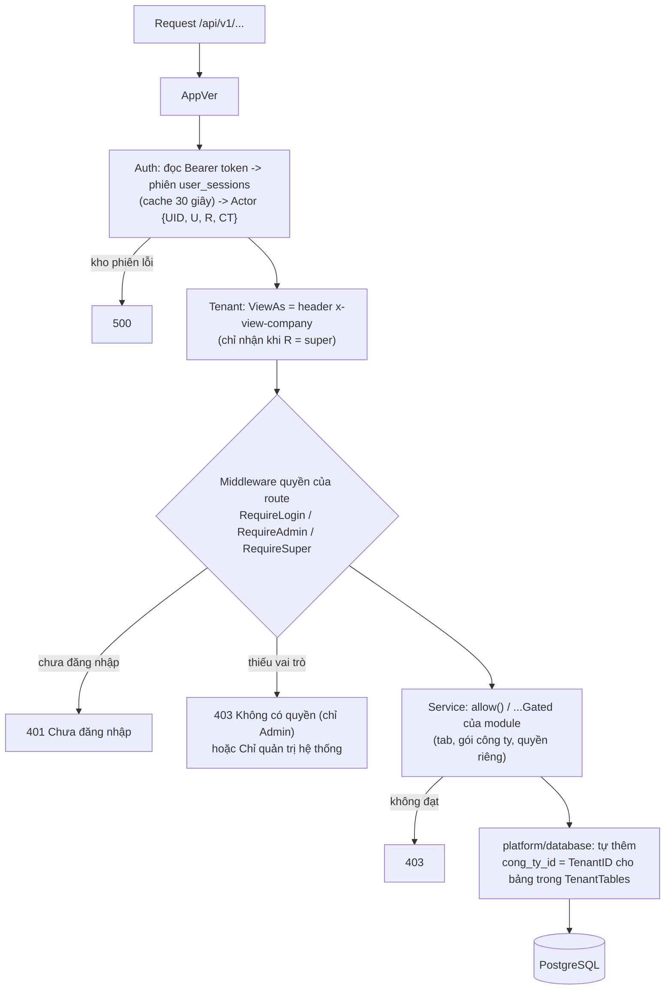
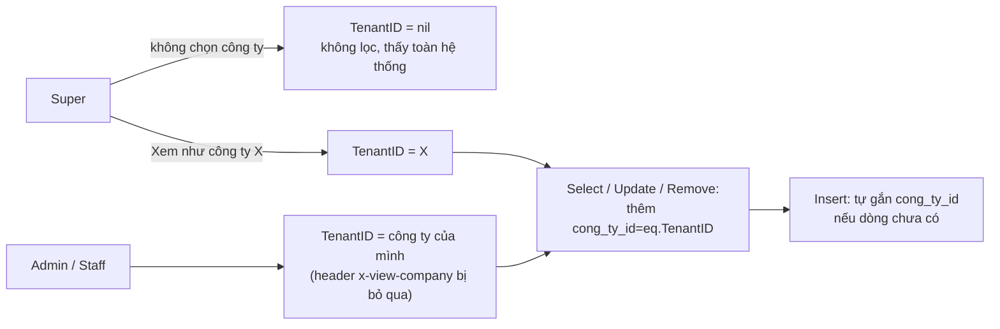
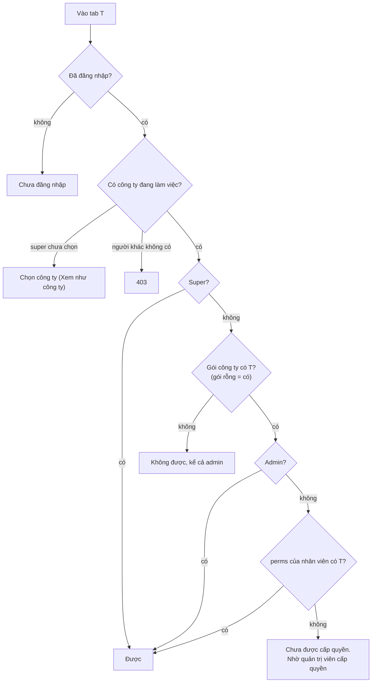
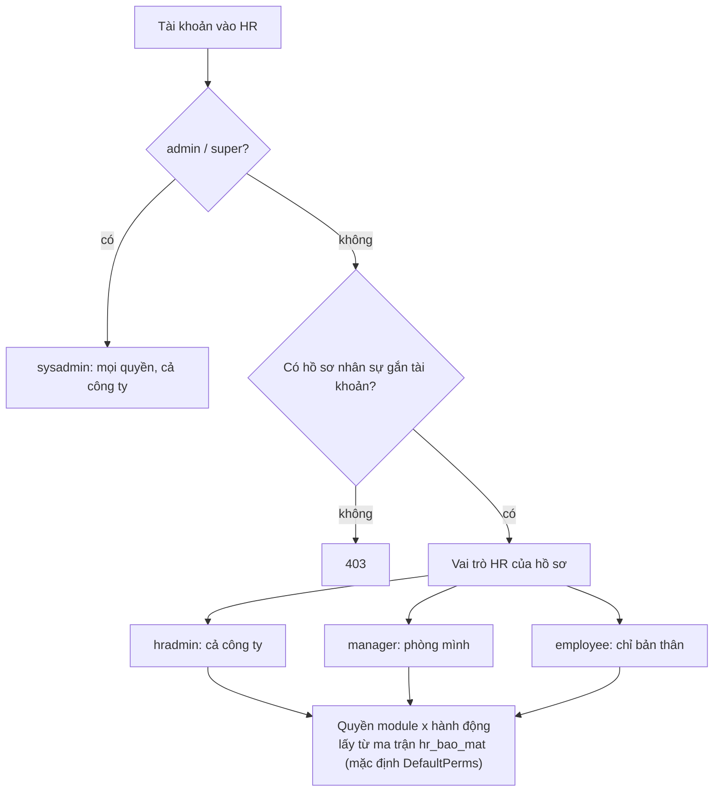

# Phân quyền - luồng và kiến trúc

Ảnh chụp cách phân quyền đang chạy trong code (nhánh `dung/duan`, 2026-11-18). Mọi điều dưới đây đọc từ code, kèm vị trí file để kiểm lại.

## 1. Tóm tắt

Phân quyền có 4 lớp, kiểm lần lượt:

| Lớp | Câu hỏi | Nằm ở |
|---|---|---|
| 1. Đăng nhập | Ai đang gọi, phiên còn sống không, công ty còn hạn không | `middleware/auth.go`, `auth/service_session.go` |
| 2. Vai trò hệ thống | `super` / `admin` / `staff` được gọi hàm này không | `middleware/rbac.go`, `server/rpc` (Login / Admin / Super) |
| 3. Công ty (tenant) | Dữ liệu của công ty nào | `middleware/tenant.go`, `shared/tenant`, `platform/database` (`TenantTables`) |
| 4. Tab và quyền riêng của module | Công ty có gói tab đó không, nhân viên có được tick tab không, module có luật riêng không | `allow()` / `...Gated` trong từng module, `canTab` ở giao diện |

Có 3 cấp người dùng: **Super → Admin công ty → Nhân viên**. Không có cấp trưởng phòng ở mức hệ thống; cấp quản lý chỉ có trong module HR.

## 2. Vai trò

Cột `users.role` chỉ nhận `super` / `admin` / `staff` (CHECK trong `infra/db/schema.sql`, mặc định `staff`).

| | Super (Quản trị hệ thống) | Admin (Quản trị công ty) | Staff (Nhân viên) |
|---|---|---|---|
| Thuộc công ty | Không (`company_id` null) | 1 công ty | 1 công ty |
| Thấy dữ liệu | Mọi công ty; chọn "Xem như công ty" để làm việc trong 1 công ty | Chỉ công ty mình | Chỉ công ty mình, chỉ tab được cấp |
| Tạo / xoá công ty, sửa gói, hạn dùng, số tài khoản | Có | Không | Không |
| Sửa tên, logo, email, SĐT công ty | Có | Có (công ty mình) | Không |
| Tạo tài khoản | Mọi công ty, mọi vai trò (kể cả super) | Trong công ty mình, vai trò staff hoặc admin | Không |
| Chuyển tài khoản sang công ty khác | Có | Không | Không |
| Vào tab | Mọi tab, không bị gói công ty chặn | Mọi tab trong gói công ty | Tab được admin tick và có trong gói |

Ghi chú:
- `IsAdmin()` đúng cho cả admin và super; `IsSuper()` chỉ super (`backend/internal/shared/actor/actor.go:26-30`).
- Comment ở `actor.go:18` ghi vai trò là `"user"`, nhưng giá trị thật là `staff`.
- Giao diện gọi tên: super = "Quản trị hệ thống", admin = "Quản trị công ty", staff = "Nhân viên" (`frontend/src/components/layout/Topbar.jsx:9`).

## 3. Luồng một request



- Thứ tự middleware của nhóm `/api/v1`: AppVer → Auth → Tenant (`backend/internal/server/routes.go:78`).
- Auth chỉ gắn Actor vào request, không tự chặn. Việc chặn do middleware quyền làm (`backend/internal/middleware/auth.go:73-100`, `rbac.go:11-52`).
- Actor là nil (coi như chưa đăng nhập) khi: tài khoản bị khoá, phiên bị thu hồi, hoặc người không phải super mà không có công ty / công ty tắt / hết hạn (`backend/internal/modules/auth/service_session.go:143-199`).
- Cổng cũ `POST /api/:fn` dùng cùng mức quyền qua Registry: `rpc.Login` (mặc định), `rpc.Public`, `rpc.Admin`, `rpc.Super`, `rpc.SelfAuth` (chỉ route bản Go) (`backend/internal/server/rpc/rpc.go:32-40`, `:287-298`).
- `RequireAdminSuper` đòi cả hai điều kiện, nên thực chất chỉ super qua (`rbac.go`).

## 4. Tách dữ liệu theo công ty (tenant)



- `TenantID` = ViewAs nếu có, không thì công ty của người đăng nhập (`backend/internal/shared/tenant/tenant.go:36-45`).
- 61 bảng theo công ty khai trong `TenantTables` (`backend/internal/platform/database/postgres.go:38-51`); `withScope` tự thêm điều kiện lọc cho Select / Update / Remove.
- Tài khoản không phải super mà không có công ty thì bị chặn với lỗi "Tài khoản chưa gắn với công ty nào" (`postgres.go:266-287`).
- `NoScope` bỏ lọc, chỉ dùng cho truy cập xuyên công ty thật sự (đăng nhập, phiên, super liệt kê tài khoản toàn hệ thống).
- Các module Kinh doanh, HR, Triển khai bắt super phải chọn "Xem như công ty" trước khi dùng.
- Một tài khoản chỉ thuộc một công ty; tên đăng nhập là duy nhất toàn hệ thống.

## 5. Quản lý tài khoản và công ty

### Tạo công ty mới

```mermaid
sequenceDiagram
    participant S as Super
    participant C as companies.CreateCongTy
    participant U as users.AdminCreateUser
    S->>C: tên công ty, gói tính năng, giới hạn tài khoản, adminUser, adminPass
    C->>C: chỉ super (rpc.Super + RequireSuper + kiểm trong service)
    C->>C: sinh mã (slug) từ tên, kiểm trùng; kiểm trùng tên admin
    C->>U: trong cùng transaction: role = admin, congTyId = công ty mới
    U-->>S: công ty + admin đầu tiên
```

Nguồn: `backend/internal/modules/companies/service.go:261-340`. Super còn có `createCongTyUser` để tạo tài khoản cho công ty bất kỳ (`:368-390`).

### Luật tạo / sửa tài khoản (`backend/internal/modules/users/service.go`)

- Mọi hàm quản lý tài khoản (`adminListUsers`, `adminCreateUser`, `adminUpdateUser`, `adminSetPassword`, `adminSetActive`, `adminDeleteUser`, `getAuditLog`) cần admin hoặc super (`users/handler.go:17-37`).
- Công ty của tài khoản mới: super được chọn tay; người khác thì là công ty đang làm việc (`:147-156`).
- Vai trò: `admin` gán được mà không kiểm người tạo, nên **admin tạo được admin khác**. `super` chỉ super gán được; người khác gửi `super` thì khi tạo nhận `staff`, khi sửa giữ vai trò cũ. Tài khoản đang là super luôn giữ super (`:178-187`, `:265-287`).
- Admin chỉ thao tác được tài khoản cùng công ty; tài khoản công ty khác hoặc super báo "Không tìm thấy tài khoản" (`targetUser`, `:218-234`).
- Không cho công ty mất admin đang hoạt động cuối cùng: chặn khi khoá, xoá hoặc hạ vai trò (`keepLastAdmin`, `:237-249`).
- Chặn tạo khi vượt `user_limit` của công ty (0 = không giới hạn; mặc định 10 khi tạo công ty) (`:164-177`).
- Tên đăng nhập: chữ thường, khớp `^[a-z0-9._-]{3,}$`, duy nhất toàn hệ thống; mật khẩu tối thiểu 4 ký tự.
- Chỉ super chuyển được tài khoản sang công ty khác (`:295-298`).
- Admin sửa công ty mình được: tên, logo, màu, email, SĐT. Gói tính năng, giới hạn tài khoản, bật / tắt, hạn dùng chỉ super sửa (`companies/service.go:408-472`).
- Tài khoản super đầu tiên tạo bằng `infra/scripts/create-super.sh` (role super, company_id null).

## 6. Quyền theo tab

### Dữ liệu

- `companies.features` (`tinh_nang`): danh sách tab của gói công ty. Rỗng = mọi tab.
- `users.permissions` (`perms`): chuỗi mã tab ngăn bằng dấu phẩy, chỉ có nghĩa với staff. Admin / super để rỗng = không giới hạn.
- Danh sách mã tab (`frontend/src/pages/QS/state/store.js:20-27`):
  - Tab QS (`PERM_TABS`): `dash, boc, chiphi, export, muahang, duan, sanpham, import`
  - Trang làm việc (`WORK_TABS`): `kinhdoanh, thietke, thicong, hr`
  - Trang khác (`PAGE_TABS`): `newsfeed, chat, marketing, taichinh, bim, sanxuat, it, rd, banlamviec, lich, wiki`
  - Cờ thêm: `sp_edit`, `sp_duyet` (sản phẩm), `da_duyet` (duyệt sửa dự án)

### Cách kiểm



- Backend: `allow()` của Kinh doanh (`backend/internal/modules/sales/service.go:186-219`), HR (`hr/service.go:69-99`), Triển khai (`delivery/service.go:72-109`) theo đúng thứ tự trên.
- Giao diện: `canTab` (`frontend/src/services/workSession.js:133-140`) là bản giao diện của luật trên. Trong QS có `canTab` riêng (`frontend/src/pages/QS/state/store.js:77-96`): tab `congty` chỉ super, tab `admin` cho admin / super.
- Thanh bên chỉ hiện mục người dùng được vào (`canPage`, `frontend/src/components/layout/Sidebar.jsx:65-70`).
- `PageGuard` chặn vào thẳng bằng URL và chuyển sang trang đầu tiên được phép (`frontend/src/components/layout/PageGuard.jsx:7-24`).
- `WorkGate` bọc các trang Kinh doanh (`kinhdoanh`), Quản lý thiết kế (`thietke`), Quản lý dự án (`thicong`), HR (`hr`).
- Admin cấp tab cho nhân viên ở **Cài đặt > Admin > sửa tài khoản** (`frontend/src/pages/QS/components/admin/UserModal.jsx`); khối "Quyền truy cập" chỉ hiện với vai trò staff.

## 7. HR: lớp quyền thứ hai (cấp quản lý)

HR là module duy nhất có cấp quản lý theo phòng ban. Sau khi qua `allow()` (tab `hr`), mỗi thao tác qua `gate` (`backend/internal/modules/hr/access.go:140-181`).



- Phạm vi dữ liệu: sysadmin / hradmin = cả công ty, manager = cùng `phong_ban` (phòng chính của hồ sơ), employee = bản thân (`access.go:21`, `:84-104`).
- Quyền mặc định của manager: xem nhân sự, duyệt chấm công, xem / sửa / duyệt tuyển dụng, đánh giá. Không có quyền vào lương.
- Hồ sơ HR tạo với cấp "Trưởng phòng" hoặc "Giám đốc" tự nhận vai trò manager (`hr/service.go:253-255`).
- Quyền manager đến từ vai trò HR của hồ sơ, không đến từ việc đặt làm trưởng đơn vị trong sơ đồ "Cơ cấu phòng ban" (`head_employee_id` chỉ dùng lấy tên người duyệt).
- `manager_id` (quản lý trực tiếp) dùng cho: bước duyệt đầu tiên của đơn chấm công; quyền chấm đánh giá cho cấp dưới trực tiếp và người cùng phòng.
- Sửa ma trận quyền và gán vai trò HR cần quyền `security / edit`; theo mặc định chỉ sysadmin có.
- Cờ `an_luong` bật thì ẩn lương.

## 8. Quyền riêng của từng module

| Module | Luật | Nguồn |
|---|---|---|
| Kinh doanh | Tab `kinhdoanh` (mục 6). Trong trang không có quyền chi tiết hơn; "Phụ trách" của khách hàng chỉ là thông tin | `sales/service.go:186-219` |
| Quản lý thiết kế / thi công | Tab `thietke` / `thicong` | `delivery/service.go:72-109` |
| HR | Tab `hr` + lớp quyền HR (mục 7) | `hr/access.go` |
| Sản phẩm | admin / super: sửa và duyệt. Staff có `sp_duyet`: sửa và duyệt. Chỉ `sp_edit`: chỉ sửa (sửa xong về "Chưa duyệt"). Không có cờ nào: sửa và duyệt (giữ như cũ để không khoá tài khoản đang dùng) | `materials/service.go:185-214` |
| Dự toán / công tác | Dùng chung quyền Sản phẩm: lưu / sửa / xoá cần quyền sửa, duyệt cần quyền duyệt; đánh dấu yêu thích ai cũng được | `estimates/service_write.go:260-316` |
| Bóc tách | Lưu dòng thành sản phẩm cần quyền sửa sản phẩm | `takeoff/service.go:263-271` |
| Sao chép sản phẩm riêng | Super; hoặc công ty có tính năng `sanpham` và (admin hoặc perms `sanpham`) | `materials/service_private_copy.go:37-66` |
| Dự án | Duyệt yêu cầu sửa dự án: admin / super hoặc perms `da_duyet` | `projects/service_edit_requests.go:69-82` |
| Mua hàng | Xem toàn bộ và duyệt đơn / đề xuất: chỉ admin / super. Nhân viên chỉ xem phiếu của mình | `purchasing/handler.go:58-111`, `service_proposals.go:220-231` |
| IT | Thành viên công ty gửi được yêu cầu và chỉ thấy yêu cầu mình gửi. Admin / super hoặc perms `it`: xử lý mọi yêu cầu, quản lý thiết bị. Xoá yêu cầu: chỉ admin | `it/service.go:87-149`, `:264-270` |
| Chat | Admin / super hoặc perms `chat`, nếu không báo "chưa được cấp quyền Chat" | `chat/service_dezon.go:62-72` |
| Marketing > Chi tiêu quảng cáo | Admin: mọi kênh, giao người phụ trách, sửa cấu trúc, nhập CSV, kéo thả cột. Nhân viên: chỉ "Trang nhập" với kênh mình phụ trách. `xemHq` / `xemTong`: được xem báo cáo Hiệu quả kênh. **Chỉ kiểm ở giao diện** (mục 9) | `frontend/src/pages/Marketing/components/AdsSpendTab.jsx` |
| Cài đặt | Công ty: chỉ super. Admin, Yêu cầu, Nhật ký hoạt động: admin / super. Tài khoản siêu quản trị viên: chỉ super | `frontend/src/pages/QS/QsSettingsPanels.jsx:17-34` |

## 9. Điểm cần lưu ý

1. **Quyền Marketing chưa được backend bảo vệ.** Dữ liệu chi tiêu quảng cáo lưu ở `company_settings` khoá `mkAds` qua `SetProjData('__cty','mkAds')`. Backend chỉ kiểm khoá hợp lệ, không kiểm người phụ trách kênh hay vai trò (`backend/internal/modules/projects/service_data.go:66-85`). Ai đăng nhập trong công ty cũng gọi API ghi đè được toàn bộ dữ liệu.
2. **Admin tạo được admin khác.** Đúng với thiết kế "chủ công ty", nhưng nếu muốn chỉ super cấp admin thì phải thêm kiểm ở `users/service.go:178-187`.
3. **Ô "Phòng ban" của tài khoản không cấp quyền.** Chỉ dùng để hiển thị (Kinh doanh, IT, báo cáo Lark). Cấp quản lý chỉ có trong HR.
4. **Admin không bị chặn tự khoá chính mình** (`adminSetActive`), chỉ bị chặn khi là admin cuối cùng. Tự xoá thì bị chặn.
5. **Comment lỗi thời:** `actor.go:18` ghi vai trò `"user"` (thật là `staff`); chú thích bảng `hr_employees` ghi "Not linked to login accounts" nhưng đã có cột `user_id`.
6. **Gói công ty chặn cả admin.** Tab không có trong `companies.features` thì admin cũng thấy "Chưa được cấp quyền"; chỉ super được miễn.

## 10. File chính

| Phần | File |
|---|---|
| Actor, vai trò | `backend/internal/shared/actor/actor.go` |
| Đăng nhập, phiên | `backend/internal/middleware/auth.go`, `backend/internal/modules/auth/service_session.go` |
| Middleware quyền | `backend/internal/middleware/rbac.go` |
| Cổng `/api/:fn`, mức quyền | `backend/internal/server/rpc/rpc.go` |
| Tenant | `backend/internal/middleware/tenant.go`, `backend/internal/shared/tenant/tenant.go`, `backend/internal/platform/database/postgres.go` |
| Tài khoản | `backend/internal/modules/users/service.go` |
| Công ty | `backend/internal/modules/companies/service.go` |
| HR | `backend/internal/modules/hr/access.go` |
| Giao diện | `frontend/src/services/workSession.js`, `frontend/src/pages/QS/state/store.js`, `frontend/src/components/layout/{Sidebar,PageGuard}.jsx`, `frontend/src/components/ui/WorkGate.jsx`, `frontend/src/data/navigation.js`, `frontend/src/pages/QS/components/admin/UserModal.jsx` |
